## Objetivos de aprendizaje

Al terminar esta lección podrás:

- **Importar** matplotlib (`plt`) y seaborn (`sns`) y **distinguir** las tres formas de graficar (Pandas `df.plot`, pyplot, seaborn) y cuándo conviene cada una. *(Comprender)*
- **Elegir** la gráfica según la pregunta: relación, comparar categorías, composición, distribución o tabla como color. *(Evaluar)*
- **Graficar** la relación entre dos variables: `plt.plot` con línea o solo marcadores, `sns.scatterplot(hue=)` y `sns.pairplot`. *(Aplicar)*
- **Comparar** categorías con barras (verticales, horizontales, apiladas) y con un radar de promedios normalizados. *(Aplicar)*
- **Mostrar** la composición de un todo con un pastel, y reconocer cuándo una barra lo compara mejor. *(Aplicar)*
- **Mostrar** una distribución con histogramas (de una columna y por grupo) y diagramas de caja (con escala común; por grupo). *(Aplicar)*
- **Convertir** una tabla en color con `sns.heatmap` (un `crosstab`; la matriz de correlación) y **distinguir** un colormap secuencial de uno divergente. *(Aplicar / Comprender)*
- **Rotular y personalizar** una figura: título, ejes con unidades, leyenda, colores, ticks y su rotación, `figsize`, varios paneles con límites de eje (zoom), y **guardarla** con `savefig`. *(Aplicar)*
- **Interpretar** con honestidad: una tendencia puede invertirse dentro de los grupos (paradoja de Simpson) y algunas gráficas necesitan una escala común. *(Analizar / Evaluar)*

> **Dónde encaja:** después de la L22 (*Pandas: análisis de datos*) · dentro del Módulo 3 · antes de la L24 (*Análisis de imágenes científicas*). La L21 te dio la tabla de pingüinos y la L22 la resumió en números (promedios, conteos, un `crosstab`); hoy le das **ojos**.

## Por qué importa

La L22 terminó con tablas: `Gentoo 5076.0`, `Adelie 3700.7`, un `crosstab` de especie por isla. Los números son exactos, pero cuesta verlos de un vistazo. Una **gráfica** lo dice en un segundo -- y a veces muestra algo que la tabla esconde. En esta lección vas a usar la **misma** tabla de pingüinos de la L21 y la L22 para construir más de quince gráficas, y vas a encontrar dos sorpresas: una tendencia que se **invierte** al separar por especie, y una **resolución** del instrumento que solo se ve con un zoom.

El hilo de la lección es una pregunta: **¿qué gráfica para qué pregunta?** Y una regla de oro de la ciencia: **una gráfica sin título, rótulos de eje con unidades y leyenda no comunica nada.**

| Pregunta | Gráfica | Llamada típica |
|---|---|---|
| ¿Se relacionan dos mediciones? | dispersión (marcadores) | `plt.plot(x, y, 'o')`, `sns.scatterplot(...)` |
| ¿Cómo se comparan las categorías? | barras; radar | `serie.plot.bar()`, `.plot.barh()` |
| ¿Qué parte del total es cada una? | pastel; barra apilada | `serie.plot.pie()`, `stacked=True` |
| ¿Cómo se reparte una medición? | histograma; caja | `.plot.hist(bins=)`, `sns.boxplot(...)` |
| ¿Qué patrón tiene una tabla? | heatmap | `sns.heatmap(tabla, annot=True)` |

> **Práctica (hands-on):** [Lab — Visualización científica](l23_lab_visualization.md) ·
> [](https://colab.research.google.com/github///blob//u03_scientific_computing/l23_lab_visualization.ipynb)

## Tres formas de graficar

Las gráficas de Python viven en **matplotlib**. Encima de ella hay dos atajos, y en esta lección usarás los tres, cada uno donde es más corto:

```python
import matplotlib.pyplot as plt
import numpy as np
import pandas as pd
import seaborn as sns

url = ('https://raw.githubusercontent.com/mwaskom/'
       'seaborn-data/master/penguins.csv')
df = pd.read_csv(url)
print(df.shape)
```

~~~text
(344, 7)
~~~

| Forma | Ejemplo | Úsala cuando |
|---|---|---|
| Pandas | `serie.plot.bar()` | ya tienes la Series o la tabla (un `groupby`, un `value_counts`, un `crosstab`) |
| pyplot | `plt.plot(x, y)`, `plt.title(...)` | quieres dibujar `x` contra `y` directamente, o ajustar detalles: título, ejes, tamaño, guardar |
| seaborn | `sns.boxplot(data=df, x=..., y=..., hue=...)` | quieres colorear o separar por grupo (`hue=`) en una sola llamada |

Las tres dibujan sobre matplotlib, así que `plt.title`, `plt.xlabel` y `plt.show()` funcionan con todas: puedes dibujar con Pandas o seaborn y rotular con pyplot.

## Relación entre dos mediciones: línea o marcadores

¿Los pingüinos con la aleta más larga pesan más? Son dos columnas numéricas; la función básica de pyplot, `plt.plot(x, y)`, pone una en cada eje:

```python
plt.plot(df['flipper_length_mm'], df['body_mass_g'])
plt.show()
```

`plt.plot` **une cada punto con el de la fila siguiente**. Las filas no están ordenadas por largo de aleta, así que sale una maraña (izquierda). Una **línea** solo tiene sentido cuando el eje x tiene un **orden** -- el tiempo, por ejemplo -- y los datos están en ese orden. Aquí queremos los puntos sueltos: el tercer argumento `'o'` dibuja **solo marcadores**. Y rotulamos, siempre con **unidades**:

```python
plt.plot(df['flipper_length_mm'], df['body_mass_g'], 'o')
plt.title('Masa vs largo de la aleta')
plt.xlabel('Largo de la aleta (mm)')
plt.ylabel('Masa corporal (g)')
plt.show()
```

::: {layout-ncol=2}
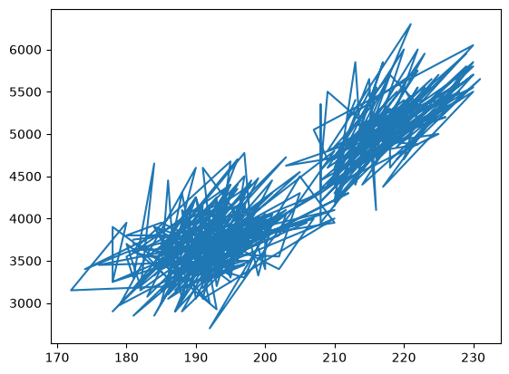{fig-alt="Gráfica de líneas que saltan de un lado a otro, sin título ni rótulos de eje: una maraña ilegible."}

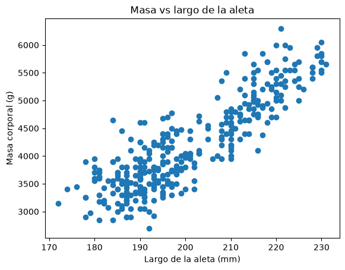{fig-alt="Gráfica de puntos de masa corporal en gramos contra largo de la aleta en milímetros; los puntos suben de izquierda a derecha."}
:::

La versión de la derecha responde la pregunta: la nube **sube** de izquierda a derecha -- a más aleta, más masa. La de la izquierda falla dos veces: el tipo (línea sin orden) y los rótulos (¿qué es cada eje?, ¿en qué unidades?). Esa es la regla de oro en acción.

**¿Y con Pandas?** En Pandas, `.plot()` **sin tipo** también dibuja una **línea**. En una tabla, `df.plot(x='flipper_length_mm', y='body_mass_g')` elige qué columna va en cada eje y dibuja esta misma maraña; con `marker='o'` agrega además un marcador en cada punto (línea y marcadores). Úsala cuando el eje x tiene un orden, por ejemplo el tiempo, y acepta los mismos `title=`, `xlabel=` y `ylabel=` que las barras de la sección siguiente.

## Comparar categorías: barras

Una **barra** compara un valor entre categorías. Es la forma natural de graficar un resumen de la L22. **Vertical:** la masa promedio por especie; `rot=0` deja los nombres horizontales y `color=` elige el color.

```python
masa = df.groupby('species')['body_mass_g'].mean().round(1)
print(masa)
masa.plot.bar(title='Masa promedio por especie',
              xlabel='Especie', ylabel='Masa promedio (g)',
              rot=0, color='seagreen')
plt.show()
```

~~~text
species
Adelie       3700.7
Chinstrap    3733.1
Gentoo       5076.0
Name: body_mass_g, dtype: float64
~~~

**Horizontal** (`.plot.barh()`): lee mejor con muchas categorías o nombres largos. `sort_values()` ordena antes de dibujar; `barh` pone la primera fila abajo, así que la más grande queda arriba. Aquí rotulamos con pyplot, que siempre sabe cuál eje es cuál:

```python
islas = df['island'].value_counts().sort_values()
print(islas)
islas.plot.barh(title='Pinguinos por isla')
plt.xlabel('Numero de pinguinos')
plt.ylabel('Isla')
plt.show()
```

~~~text
island
Torgersen     52
Dream        124
Biscoe       168
Name: count, dtype: int64
~~~

::: {layout-ncol=2}
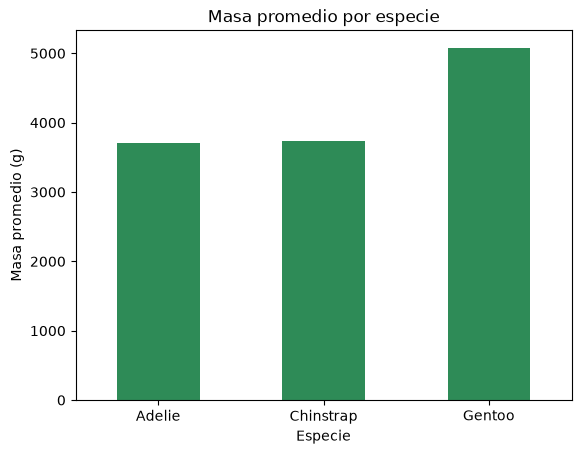{fig-alt="Tres barras verdes de masa promedio por especie; Gentoo, cerca de 5100 g, es la más alta; Adelie y Chinstrap cerca de 3700 g."}

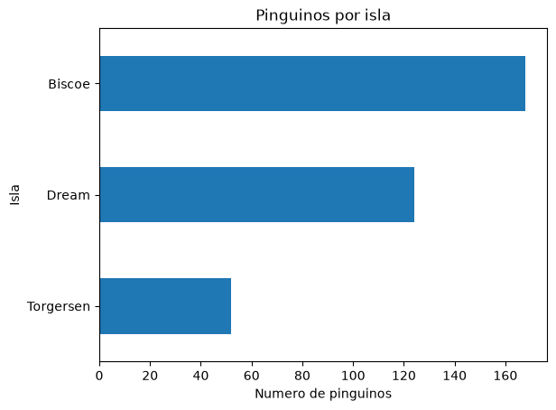{fig-alt="Tres barras horizontales con el número de pingüinos por isla; Biscoe, la más larga, arriba; Torgersen, la más corta, abajo."}
:::

Los Gentoo pesan bastante más que las otras dos especies, que casi empatan; y Biscoe es la isla con más pingüinos. *En la L22 lo calculaste; hoy lo ves.*

**Apilada:** muestra dos categorías a la vez. Partimos del `crosstab` de la L22 (especie por isla): cada especie es una barra y cada isla un trozo de color. `colormap=` elige la paleta y `plt.legend(title=...)` titula la leyenda:

```python
tabla = pd.crosstab(df['species'], df['island'])
print(tabla)
tabla.plot.bar(stacked=True, rot=0, colormap='Set2',
               title='Pinguinos por especie e isla',
               xlabel='Especie', ylabel='Numero de pinguinos')
plt.legend(title='Isla')
plt.show()
```

~~~text
island     Biscoe  Dream  Torgersen
species
Adelie         44     56         52
Chinstrap       0     68          0
Gentoo        124      0          0
~~~

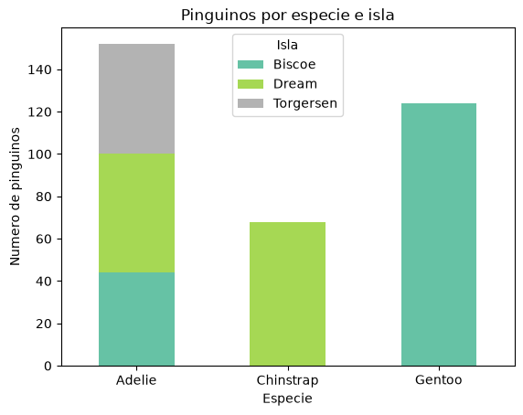{fig-alt="Tres barras apiladas: la de Adelie tiene tres colores (las tres islas); la de Chinstrap un solo color (Dream) y la de Gentoo un solo color (Biscoe)."}

La barra de Adelie tiene tres colores: vive en las tres islas. Las de Chinstrap y Gentoo tienen uno: **los Chinstrap solo viven en Dream y los Gentoo solo en Biscoe**. Los ceros de la tabla se ven como colores que faltan. Recuerda este dato: explicará una sorpresa del Lab.

## Composición de un todo: el pastel

Un **pastel** muestra qué parte del total es cada categoría. `autopct='%1.0f%%'` escribe el porcentaje sin decimales y `ylabel=''` quita el rótulo automático del lado:

```python
conteo = df['species'].value_counts()
print(conteo)
conteo.plot.pie(autopct='%1.0f%%', ylabel='',
                title='Proporcion de cada especie')
plt.show()
```

~~~text
species
Adelie       152
Gentoo       124
Chinstrap     68
Name: count, dtype: int64
~~~

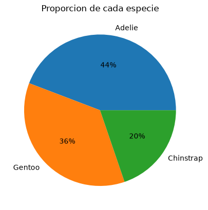{fig-alt="Gráfica de pastel en tres trozos: Adelie 44 por ciento, Gentoo 36 por ciento, Chinstrap 20 por ciento."}

Adelie es casi la mitad de la muestra (44%). El pastel sirve con **pocas** partes de un todo; para **comparar** valores, la barra es mejor, porque el ojo compara largos mucho mejor que ángulos. Sin los porcentajes escritos, ¿podrías decir cuánto más grande es el trozo de Adelie que el de Gentoo?

## Distribución de una medición: histograma y caja

Un **histograma** reparte los valores de una columna en intervalos (`bins`) y cuenta cuántos caen en cada uno: muestra la **forma** de los datos. `edgecolor='black'` dibuja el borde de cada barra. Luego, con el `groupby` de la L22, un histograma **por especie** en la misma figura; `bins=range(2700, 6400, 150)` (el `range` de la L11) da a las tres especies los **mismos** intervalos, de 150 g, para que sus barras se puedan comparar, `alpha=0.5` hace las barras semitransparentes y `legend=True` dice cuál es cuál:

```python
df['body_mass_g'].plot.hist(bins=20, edgecolor='black',
                            title='Distribucion de la masa',
                            xlabel='Masa corporal (g)',
                            ylabel='Frecuencia')
plt.show()
```

```python
df.groupby('species')['body_mass_g'].plot.hist(
    bins=range(2700, 6400, 150), alpha=0.5, legend=True)
plt.title('Distribucion de la masa por especie')
plt.xlabel('Masa corporal (g)')
plt.ylabel('Frecuencia')
plt.show()
```

::: {layout-ncol=2}
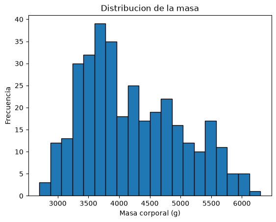{fig-alt="Histograma de la masa corporal: un pico alto entre 3500 y 4000 g y una cola larga con varias jorobas hasta 6000 g."}

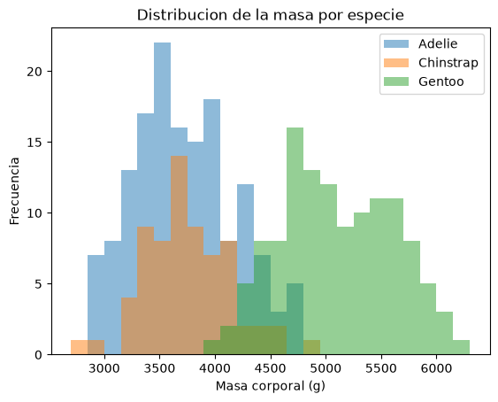{fig-alt="Tres histogramas semitransparentes superpuestos con los mismos intervalos: Adelie y Chinstrap se montan entre 3000 y 4500 g; Gentoo forma su propia montaña entre 4000 y 6300 g."}
:::

El primero tiene una forma rara: un pico y una cola larga con jorobas. El segundo lo explica: la tabla **mezcla tres especies**. Adelie y Chinstrap se montan una sobre otra; Gentoo forma su propia montaña a la derecha -- la "cola" eran los Gentoo. Un histograma de todos juntos puede esconder grupos.

Un **diagrama de caja** (box plot) resume una distribución en cinco números: la línea del medio es la **mediana**, la caja va del primer al tercer **cuartil** (la mitad central de los datos), los bigotes llegan hasta los valores más lejanos que no son raros, y los puntos sueltos son **valores atípicos**. Pandas dibuja una caja por columna numérica; `plt.xticks(rotation=45)` gira los nombres largos:

```python
df.plot.box(title='Todas las mediciones juntas')
plt.xticks(rotation=45)
plt.show()
```

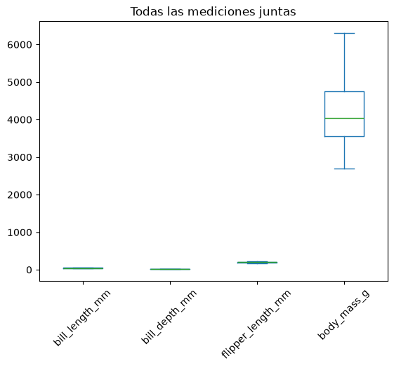{fig-alt="Cuatro diagramas de caja en un solo eje: la caja de body_mass_g llega a 6000 y las tres de medidas en milímetros quedan aplastadas como rayas cerca del cero."}

¡Las cajas en milímetros quedan aplastadas! La masa (miles de gramos) fija la escala y las demás (15 a 230 mm) son rayas cerca del cero. Es un problema de **escala**. La solución: un panel por columna, cada uno con su eje, con `subplots=True`; para que quepan, `figsize=(ancho, alto)` agranda la figura (en pulgadas):

```python
df.plot.box(subplots=True, figsize=(14, 4),
            title='Cada medicion con su propia escala')
plt.show()
```

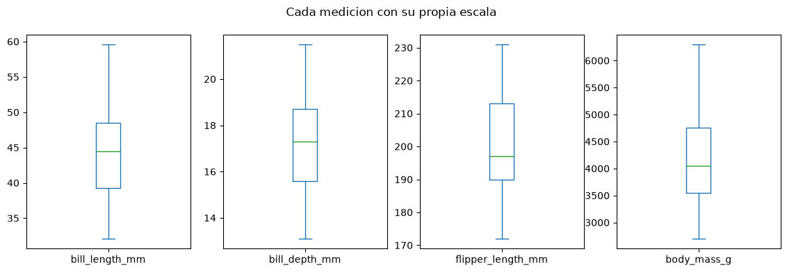{fig-alt="Cuatro diagramas de caja lado a lado, cada uno con su propio eje vertical; ahora se ve la forma de cada medición."}

Para comparar **una** medición **entre grupos**, seaborn lo hace en una llamada: `x=` es el grupo, `y=` la medición, `hue=` colorea por grupo con la paleta `palette=` y `legend=False` evita una leyenda que repetiría el eje:

```python
sns.boxplot(data=df, x='species', y='body_mass_g',
            hue='species', palette='Set2', legend=False)
plt.title('Masa por especie')
plt.xlabel('Especie')
plt.ylabel('Masa corporal (g)')
plt.show()
```

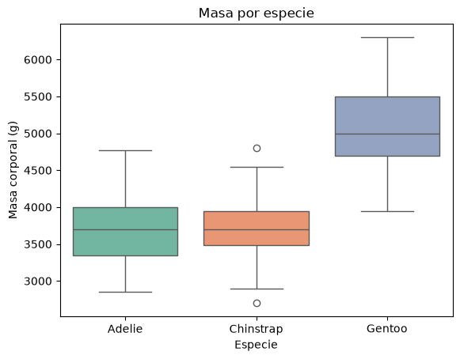{fig-alt="Tres diagramas de caja de masa corporal por especie; la caja de Gentoo está mucho más arriba; Adelie y Chinstrap tienen medianas casi iguales."}

La caja de Gentoo está mucho más arriba; Adelie y Chinstrap tienen medianas casi iguales, cerca de 3700 g, y Chinstrap tiene un par de valores atípicos. Es el mismo resumen que la barra de promedios, pero con más información: además del centro, muestra cuánto **varía** cada especie.

## Relación por grupo: dispersión, Simpson y pairplot

La nube de la primera sección, ahora con seaborn: `hue='species'` colorea cada punto según su especie y agrega la leyenda.

```python
sns.scatterplot(data=df, x='flipper_length_mm', y='body_mass_g',
                hue='species')
plt.title('Masa vs largo de la aleta, por especie')
plt.xlabel('Largo de la aleta (mm)')
plt.ylabel('Masa corporal (g)')
plt.show()
```

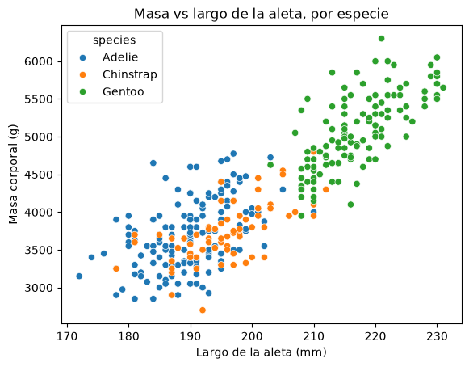{fig-alt="Dispersión de masa contra largo de la aleta en tres colores; los Gentoo forman su propio grupo arriba a la derecha; Adelie y Chinstrap se mezclan abajo a la izquierda."}

Los Gentoo forman su propio grupo arriba a la derecha; Adelie y Chinstrap se mezclan abajo a la izquierda. El color convierte una nube en tres.

**Una advertencia: la paradoja de Simpson.** Ahora el pico: ¿un pico más **largo** es también más **profundo** (más alto)? `sns.regplot` dibuja los puntos y una **recta de tendencia** (la que mejor sigue a la nube; `ci=None` quita la banda de incertidumbre). Luego `sns.lmplot` hace lo mismo **por grupo** con `hue=`:

```python
sns.regplot(data=df, x='bill_length_mm', y='bill_depth_mm',
            ci=None)
plt.title('Todos los pinguinos juntos')
plt.xlabel('Largo del pico (mm)')
plt.ylabel('Profundidad del pico (mm)')
plt.show()
```

```python
sns.lmplot(data=df, x='bill_length_mm', y='bill_depth_mm',
           hue='species', ci=None)
plt.title('Cada especie por separado')
plt.xlabel('Largo del pico (mm)')
plt.ylabel('Profundidad del pico (mm)')
plt.show()
```

::: {layout-ncol=2}
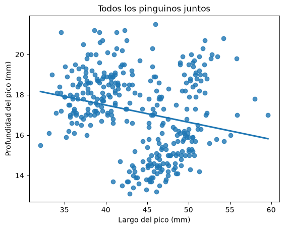{fig-alt="Dispersión de profundidad contra largo del pico de todos los pingüinos, en un solo color, con una recta de tendencia que baja."}

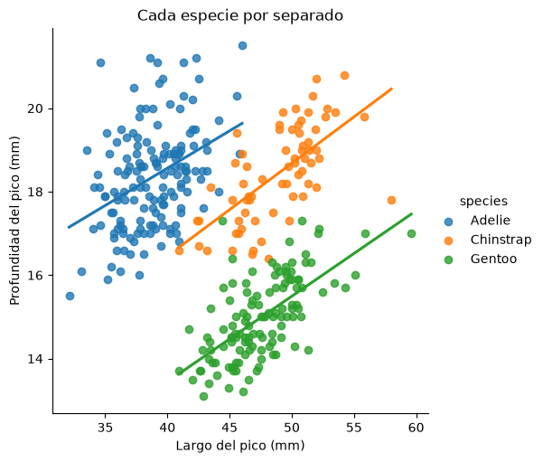{fig-alt="La misma dispersión en tres colores, con una recta por especie; las tres rectas suben."}
:::

Con todos juntos, la recta **baja**: parece que un pico más largo es menos profundo. Separados por especie, las **tres** rectas **suben**: dentro de cada especie, un pico más largo es también más profundo. Lo contrario. Esa es la **paradoja de Simpson**: una tendencia de todos los datos puede **invertirse** dentro de cada grupo. Aquí la recta de todos baja solo porque los Gentoo tienen picos largos pero poco profundos y los Adelie picos cortos pero profundos. La lección para un científico: **antes de concluir, separa o colorea por grupo.**

¿Y todas las parejas a la vez? `sns.pairplot` dibuja una cuadrícula: cada panel es la dispersión de dos columnas, y la diagonal muestra, con una **curva suavizada** (una curva de densidad, como un histograma sin escalones), la distribución de cada columna por especie:

```python
sns.pairplot(df, hue='species')
plt.show()
```

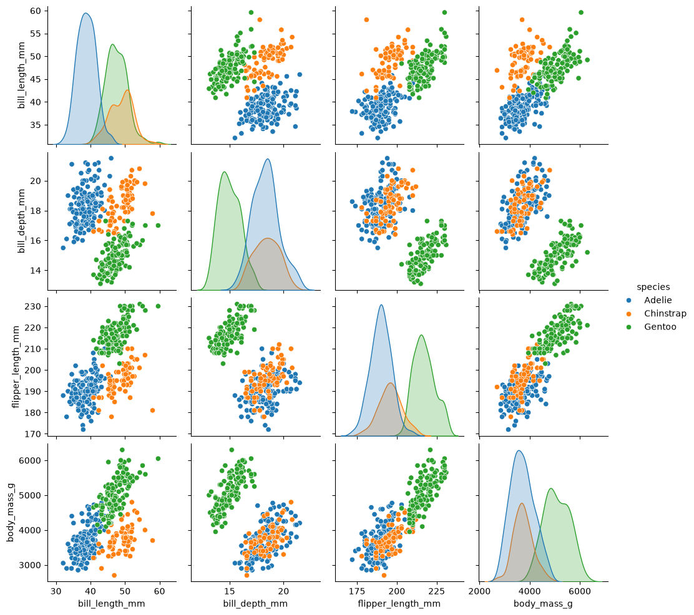{fig-alt="Cuadrícula de 4 por 4 paneles con la dispersión de cada pareja de mediciones coloreada por especie, y en la diagonal la distribución de cada medición por especie."}

Es una herramienta para **explorar** -- ¿qué parejas tienen una relación?, ¿cuáles separan bien a las especies? (el panel largo del pico vs profundidad del pico separa las tres) --, no una figura para un informe: no lleva título y es demasiado grande para leer de un vistazo.

## Una tabla como color: heatmap

Un **heatmap** (mapa de calor) pinta cada celda de una tabla con un color según su valor. `annot=True` escribe el número en la celda y `fmt='d'` lo escribe como entero. `cmap='Blues'` es un **colormap secuencial**: de blanco (poco) a azul oscuro (mucho), ideal para conteos.

```python
tabla = pd.crosstab(df['species'], df['island'])
sns.heatmap(tabla, annot=True, fmt='d', cmap='Blues')
plt.title('Pinguinos por especie e isla')
plt.xlabel('Isla')
plt.ylabel('Especie')
plt.show()
```

El uso más común del heatmap en ciencia es la **matriz de correlación**. La **correlación** `r` es un número entre -1 y 1 que mide qué tan bien dos columnas numéricas siguen una línea recta: cerca de 1, suben juntas; cerca de -1, una sube cuando la otra baja; cerca de 0, no hay relación lineal. `df.corr(numeric_only=True)` la calcula para todas las parejas. Como `r` tiene un centro natural (el 0), va un **colormap divergente** (`coolwarm`: azul negativo, blanco cero, rojo positivo), y `vmin=-1, vmax=1` fija la escala completa. `sns.heatmap` no recibe `figsize=`: el tamaño se fija **antes**, con `plt.figure(figsize=...)`.

```python
corr = df.corr(numeric_only=True)
plt.figure(figsize=(7, 5))
sns.heatmap(corr, annot=True, fmt='.2f', cmap='coolwarm',
            vmin=-1, vmax=1)
plt.title('Correlacion entre las mediciones')
plt.show()
```

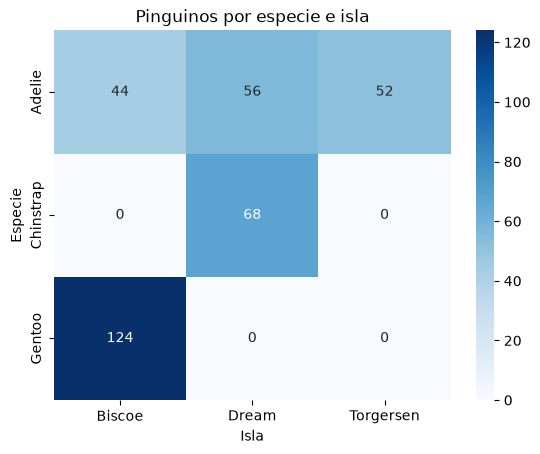{fig-alt="Cuadrícula de 3 por 3 en tonos de azul con los conteos de especie por isla; la celda Gentoo-Biscoe, 124, es la más oscura; los ceros son blancos."}

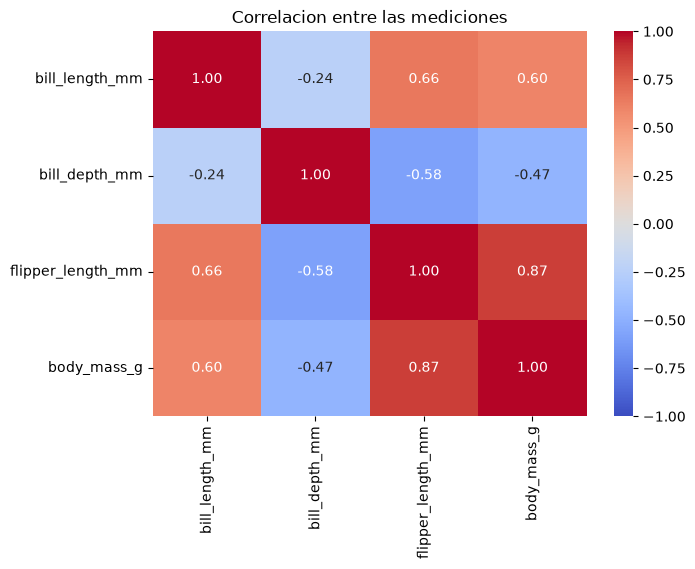{fig-alt="Cuadrícula de 4 por 4 en rojo y azul con las correlaciones entre las mediciones; la diagonal vale 1; aleta y masa 0.87; largo y profundidad del pico -0.24."}

La diagonal vale 1.00 (cada columna consigo misma). La correlación más fuerte es aleta-masa, `0.87`: la nube que sube de la primera sección. La de largo con profundidad del pico es `-0.24`: la recta que bajaba. Pero Simpson nos advirtió que ese número mezcla especies. Dentro de cada una:

```python
for especie in ['Adelie', 'Chinstrap', 'Gentoo']:
    grupo = df[df['species'] == especie]
    r = grupo['bill_length_mm'].corr(grupo['bill_depth_mm'])
    print(especie, round(r, 2))
```

~~~text
Adelie 0.39
Chinstrap 0.65
Gentoo 0.64
~~~

Las tres son **positivas**: Simpson en números. Un heatmap de correlación de todos los datos es un buen primer vistazo, no una conclusión.

## El perfil de cada especie: radar

Un **radar** (gráfica polar) dibuja varias mediciones en ejes que salen del centro, como los rayos de una rueda; cada especie es un polígono que cierra su perfil. Sus ingredientes son ángulos iguales para cada medición (`np.linspace`), ejes circulares (`plt.subplot(polar=True)`) y el nombre de cada medición en su rayo (`plt.xticks(posiciones, nombres)`); el Lab los guarda en una función `radar(tabla, titulo)`. Con los **promedios** por especie tal cual, el radar no sirve (la primera figura de abajo): `body_mass_g` (unos 4000) aplasta todo en una aguja. Es el mismo problema de escala de las cajas. La solución es **normalizar**: llevar cada columna a una escala común de 0 a 1, restando el mínimo y dividiendo entre el rango de **todos** los pingüinos, en una operación vectorizada (L20). En el código, `cols` es la lista de las cuatro mediciones, `prom` su promedio por especie y `radar` la función que dibuja; los tres se definen en el Lab:

```python
minimo = df[cols].min()
maximo = df[cols].max()
norm = (prom - minimo) / (maximo - minimo)
print(norm.round(2))
radar(norm, 'Promedios normalizados (0 a 1)')
```

~~~text
           bill_length_mm  bill_depth_mm  flipper_length_mm  body_mass_g
species
Adelie               0.24           0.62               0.30         0.28
Chinstrap            0.61           0.63               0.40         0.29
Gentoo               0.56           0.22               0.77         0.66
~~~

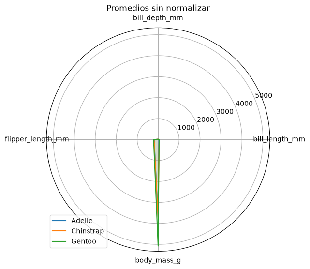{fig-alt="Radar de los promedios sin normalizar: los tres polígonos se aplastan en una aguja hacia el rayo body_mass_g."}

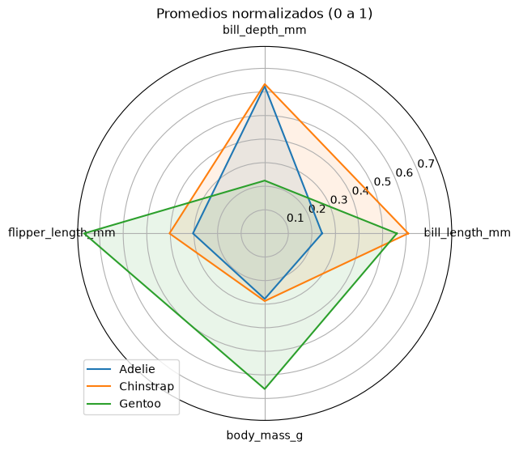{fig-alt="Radar de los promedios normalizados de 0 a 1: cada especie tiene un polígono distinto; Gentoo se estira hacia aleta y masa; Adelie y Chinstrap hacia la profundidad del pico."}

Ahora cada especie tiene su **perfil**. Gentoo: aleta larga y mucha masa, pero el pico menos profundo. Adelie: pico corto. Chinstrap: pico largo y profundo. Un 0 es el pingüino más pequeño en esa medición y un 1 el más grande.

## Dos paneles, un zoom y guardar la figura

Para terminar, una figura con **dos paneles**. `plt.subplots(1, 2, figsize=(12, 5))` crea 1 fila y 2 columnas de ejes y devuelve dos cosas: la figura (`fig`) y el par de paneles `(izq, der)`, que se desempaquetan como en la L19; seaborn recibe `ax=` para saber dónde dibujar, y en cada panel los rótulos van con `set_title`, `set_xlabel` y `set_ylabel`. A la derecha, un **zoom**: `set_xlim` y `set_ylim` fijan los **límites** de los ejes a una región, como una lupa. Y `fig.savefig(...)` guarda la figura en un archivo PNG (`dpi=150` es la resolución), **antes** de `plt.show()`: `show` muestra la figura y la borra, así que guardar después daría una imagen en blanco.

```python
fig, (izq, der) = plt.subplots(1, 2, figsize=(12, 5))
sns.scatterplot(data=df, x='flipper_length_mm', y='body_mass_g',
                hue='species', ax=izq)
sns.scatterplot(data=df, x='flipper_length_mm', y='body_mass_g',
                hue='species', ax=der, legend=False)
der.set_xlim(200, 215)
der.set_ylim(3500, 5000)
izq.set_title('Todos los pinguinos')
der.set_title('Zoom: donde se juntan las especies')
for panel in [izq, der]:
    panel.set_xlabel('Largo de la aleta (mm)')
    panel.set_ylabel('Masa corporal (g)')
fig.savefig('pinguinos_zoom.png', dpi=150)
plt.show()
```

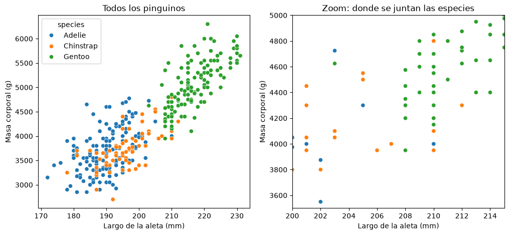{fig-alt="Dos paneles lado a lado: a la izquierda la nube completa de masa contra aleta por especie; a la derecha un zoom de 200 a 215 mm y 3500 a 5000 g donde los puntos forman columnas verticales."}

El zoom muestra la región donde las tres especies se tocan, y revela algo que la vista completa esconde: los puntos forman **columnas** verticales, porque la aleta se midió en **milímetros enteros**. Los datos tienen la **resolución** del instrumento -- y la masa también: las 342 masas medidas son múltiplos de 25 g (el Lab lo comprueba).

## Rotular bien una gráfica

La regla de oro, reunida en una tabla. Cada elemento apareció en algún ejemplo de arriba:

| Elemento | Para qué | Cómo |
|---|---|---|
| Título | qué muestra la gráfica | `title='...'` o `plt.title('...')` |
| Rótulos de los ejes, con unidades | qué es cada eje y en qué se mide | `xlabel=` / `ylabel=` o `plt.xlabel('Masa corporal (g)')` |
| Leyenda | qué es cada serie o color | automática con varias series o `hue=`; `plt.legend(title=...)` |
| Colores | distinguir o resaltar | `color=`, `colormap=`, `palette=`, `cmap=` |
| Ticks | etiquetas legibles en los ejes | `rot=0`, `plt.xticks(rotation=45)`, `plt.xticks(posiciones, nombres)` |
| Tamaño | que quepa y se lea | `figsize=(ancho, alto)` o `plt.figure(figsize=...)` |
| Varios paneles y zoom | comparar lado a lado; ver de cerca | `plt.subplots(1, 2)`, `set_xlim` / `set_ylim` |
| Guardar | usar la figura en un informe | `plt.savefig(...)` / `fig.savefig(...)` antes de `plt.show()` |

## Preguntas frecuentes

**"¿Pandas, pyplot o seaborn?"** — Usa el más corto para la tarea. Si ya tienes la Series o la tabla (un `groupby`, un `value_counts`, un `crosstab`), Pandas: `serie.plot.bar()`. Si quieres colorear o separar por grupo, seaborn con `hue=`. Para dibujar `x` contra `y` directamente y para los detalles (título, ejes, tamaño, guardar), pyplot. Como las tres dibujan sobre matplotlib, se pueden mezclar en la misma figura.

**"¿Cuándo una línea y cuándo marcadores?"** — Una línea une los puntos en el orden de las filas, así que solo tiene sentido si el eje x tiene un orden (el tiempo, una dosis creciente) y la tabla está en ese orden. Si cada fila es un individuo distinto, como un pingüino, van marcadores sueltos.

**"¿Por qué normalizar el radar y no las barras?"** — Porque el radar pone mediciones **distintas** (mm y g) en el mismo dibujo: sin una escala común, la más grande aplasta a las demás. Una barra compara la **misma** medición entre categorías, con una sola unidad, y no lo necesita.

**"¿Qué es la paradoja de Simpson y por qué me importa?"** — Es cuando una tendencia de todos los datos juntos se invierte (o desaparece) dentro de cada grupo. Pasa cuando los grupos difieren mucho entre sí. Te importa porque una conclusión sacada de la nube completa ("un pico más largo es menos profundo") puede ser falsa para cada especie.

**"¿Por qué `savefig` antes de `show`?"** — `plt.show()` muestra la figura y luego la borra. Si guardas después, el archivo queda en blanco.

## Para reflexionar

Practica y discute (en clase o por escrito):

1. Tienes la temperatura de un reactor medida cada minuto durante una hora. ¿Línea o marcadores? ¿Por qué aquí sí tiene sentido unir los puntos?
2. ¿Qué le falta a una gráfica cuyo eje y solo dice "0, 100, 200" sin más?
3. En el `crosstab` de especie por isla, ¿qué muestra mejor la barra apilada y qué muestra mejor el heatmap?
4. Un compañero concluye, con la nube de todos los pingüinos, que "un pico más largo es menos profundo". ¿Qué gráfica le mostrarías y qué le dirías?
5. ¿Por qué el radar sin normalizar es una aguja, y qué tiene eso en común con las cajas aplastadas?

## Resumen

| Idea clave | En una frase |
|------------|--------------|
| Tres formas | Pandas (`serie.plot.<tipo>()`), pyplot (`plt.plot`, `plt.title`, `plt.savefig`) y seaborn (`sns.<grafica>(..., hue=)`), todas sobre matplotlib |
| Relación | marcadores (`'o'`, `sns.scatterplot`); línea solo si x tiene orden; `sns.pairplot` para explorar |
| Comparar | barras verticales, horizontales (`barh`) y apiladas (`stacked=True`); radar de promedios normalizados |
| Composición | pastel con pocas partes (`autopct=`); la barra compara mejor |
| Distribución | histograma (`bins=`, por grupo con `alpha=`); caja (`subplots=True` si las escalas difieren; `sns.boxplot` por grupo) |
| Tabla como color | `sns.heatmap`; colormap secuencial para conteos, divergente (`vmin=-1, vmax=1`) para correlaciones |
| Detalles | título, ejes con **unidades**, leyenda, colores, ticks, `figsize`, `plt.subplots` + `set_xlim`, `savefig` antes de `show` |
| Honestidad | separa por grupo antes de concluir (Simpson); da una escala común a mediciones distintas |

## Para profundizar

- **Texto del curso (código abierto):** *Introducción a la programación con Python 3* (Marzal, Gracia y García, UJI/Sapientia, licencia CC).
- **Documentación oficial:** *Chart visualization* en `pandas.pydata.org`, la galería de `matplotlib.org` y el *tutorial* de `seaborn.pydata.org` (con galerías de cada tipo de gráfica).
- **Datos:** Palmer Penguins (Gorman, Williams y Fraser, 2014; licencia CC0), la misma tabla de la L21 y la L22.
- **Más allá de esta lección:** hay más tipos de gráfica (de violín `sns.violinplot`, curvas de densidad `sns.kdeplot`), estilos y temas (`sns.set_theme`), anotaciones con flechas y texto, y gráficas interactivas. En la **S24** verás que una **imagen** también es datos -- un arreglo de NumPy -- y la mostrarás con matplotlib. La idea de hoy -- *elige la gráfica según la pregunta, rotúlala con unidades y separa por grupo antes de concluir* -- es la base de toda comunicación científica con datos.
