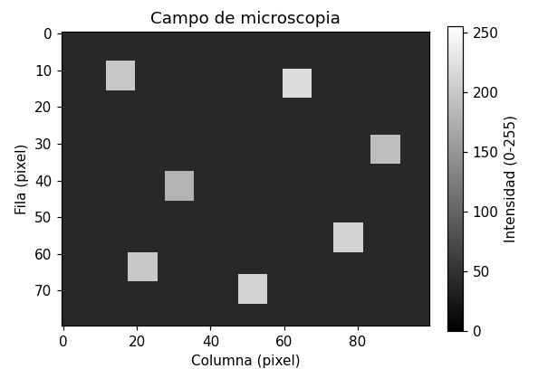
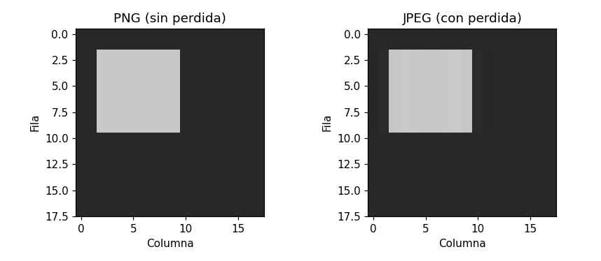
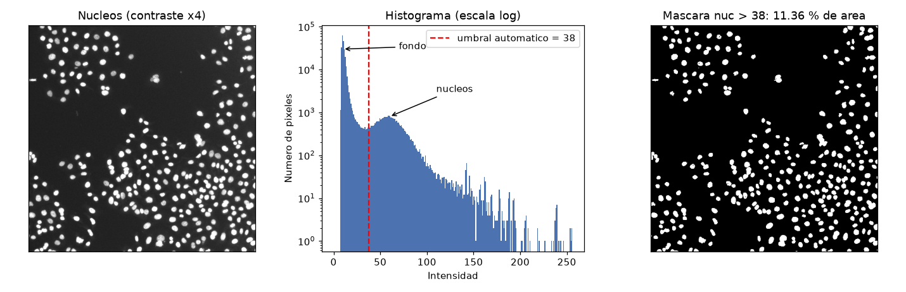
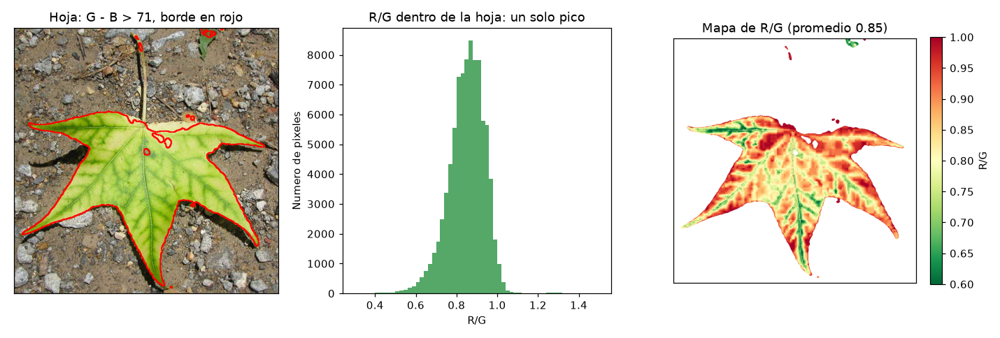
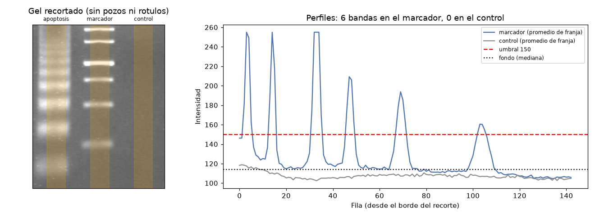

## Objetivos de aprendizaje

Al terminar esta lección podrás:

- **Explicar** que una imagen en escala de grises es un arreglo 2D (un solo canal; la imagen a color de la L20 tiene tres) y **abrirla** con `Image.open`, `np.array` y `convert('L')` (`format`, `mode`, `shape`, `dtype`). *(Comprender)*
- **Reconocer** los formatos sin pérdida (PNG/TIFF) y con pérdida (JPEG), y **cuándo importa** la diferencia: para medir intensidades sí; para medir área, apenas. *(Comprender)*
- **Elegir** un umbral con el histograma de píxeles (el valle; escala logarítmica), **calcularlo** automáticamente con un `while` y máscaras, y **medir** el porcentaje de área. *(Aplicar)*
- **Segmentar** una imagen a color combinando canales (`G - B` con `astype(int)`), **limpiar** la máscara con un filtro de mediana, **trazar** su borde y **medir** el área y un índice de color R/G. *(Aplicar)*
- **Ajustar** el contraste con aritmética (`* k`, `+ c`, `np.clip`) y **excluir** regiones sin interés con un rebanado, distinguiendo "ver mejor" de "medir distinto". *(Aplicar)*
- **Contar** bandas con un perfil robusto (el promedio de una franja, `mean(axis=1)`) y una función de estado, con el umbral por encima del fondo. *(Analizar)*
- **Usar la IA con responsabilidad:** escribir un prompt técnico (contexto, meta, restricciones, verificación) y **verificar** la respuesta con medidas propias. *(Evaluar)*

> **Dónde encaja:** después de la L23 (*Visualización científica*) · dentro del Módulo 3 · antes de la L25 (*Biopython*). En la L20 armaste una imagen a color como un arreglo 3D y la pintaste con rebanadas y máscaras. Hoy pasas de *fabricar* imágenes a *analizar* imágenes científicas reales: una micrografía, una hoja y un gel.

## Por qué importa

Un microscopio, una cámara o un escáner de geles no entregan una tabla: entregan una **imagen**. Y una imagen es un arreglo de números, así que todo lo que sabes de NumPy aplica. El análisis de imágenes científico responde casi siempre tres preguntas: **¿dónde está la señal?** (separar núcleos, hojas o bandas del fondo), **¿cuánta hay?** (área, intensidad) y **¿cuántos objetos hay?** (contar).

En una imagen fabricada las tres respuestas son obvias. En una real no: el fondo no es negro, la señal no es uniforme, el color varía y los objetos se tocan. Por eso hoy aprendes a **leer el histograma** antes de umbralizar, a **combinar canales** de color, a **limpiar** una máscara y a sacar un **perfil robusto**. Y como la IA puede proponer técnicas que este curso no cubre, aprendes también a **pedirle** ayuda con precisión y, sobre todo, a **verificar** lo que responde.

> **Práctica (hands-on):** [Lab — Análisis de imágenes científicas](l24_lab_scientific_images.md) ·
> [](https://colab.research.google.com/github///blob//u03_scientific_computing/l24_lab_scientific_images.ipynb)

## Una imagen es un arreglo

Pillow (`PIL`) abre la imagen y NumPy la convierte en arreglo. Una imagen en **escala de grises** tiene **un solo canal** (modo `L`): es un arreglo **2D** `(alto, ancho)` de enteros `uint8` (0 negro, 255 blanco). Una imagen **a color** (modo `RGB`) tiene tres canales: es el arreglo **3D** `(alto, ancho, 3)` de la L20. Si una imagen llega a color o en modo **paleta** (`P`, colores numerados) y quieres grises, `convert('L')` la convierte.

```python
from PIL import Image
import numpy as np

img = Image.open('imagenes/l24_nucleos.tif')
nuc = np.array(img)
print(img.format, img.mode, nuc.shape, nuc.dtype)   # TIFF L (512, 512) uint8
```

Las tres imágenes reales del lab muestran los tres casos:

| Imagen | Formato | Modo | `shape` |
|---|---|---|---|
| núcleos (micrografía) | TIFF | `L` (grises) | `(512, 512)` |
| hoja con clorosis | JPEG | `RGB` (color) | `(603, 600, 3)` |
| gel de ADN | PNG | `P` (paleta) -> `convert('L')` | `(193, 178)` |

Antes, un calentamiento con una imagen **fabricada** con NumPy (un fondo de 40 con siete cuadros de 180 a 220) muestra las ideas sin ruido:

{fig-alt="Campo de microscopía simulado con siete cuadros brillantes sobre un fondo oscuro y una barra de intensidad."}

El fondo es oscuro (40) y los cuadros son brillantes (180-220). La **barra de color** traduce número a gris. Con `vmin=0, vmax=255`, `plt.imshow` usa la escala completa, así cada gris corresponde a su número real; sin ellos, matplotlib "estira" el contraste al mínimo y máximo de la imagen.

## Formatos de imagen científica

**PNG** y **TIFF** son *sin pérdida*: guardan los valores de píxel exactos. **JPEG** es *con pérdida*: comprime alterando valores. Guardar el campo sintético en ambos formatos y reabrirlo lo demuestra:

{fig-alt="Comparación ampliada: PNG conserva una región uniforme y JPEG introduce bordes y manchas de compresión."}

El PNG devuelve el arreglo idéntico; el JPEG no (algunos píxeles cambian hasta en 15) y se ven artefactos cerca de los bordes. Pero fíjate en **qué medición** cambia:

| Medición sobre el campo sintético | PNG | JPEG |
|---|---|---|
| ¿idéntico al original? | sí | no (diferencia máxima 15) |
| área con umbral 120 | 5.6 % | 5.6 % |
| intensidad promedio | 49.04 | 49.01 |

El **área** no cambia (los errores de compresión son pequeños frente a la distancia entre fondo y señal); la **intensidad** sí. Por eso los microscopios guardan en TIFF: para medir intensidades (cuánta fluorescencia, cuánto ADN en una banda) necesitas los valores exactos. Una foto JPEG, como la de la hoja, sirve para medir **área**, no intensidades finas. Un **promedio** sobre muchos píxeles (como el índice de color de la hoja, más abajo) apenas cambia, así que sirve para comparar fotos tomadas igual; para color absoluto haría falta una foto sin pérdida y una tarjeta de color de referencia.

## El histograma guía el umbral

La **umbralización** (`mascara = arr > umbral`, la máscara booleana de la L20 en 2D) separa la señal del fondo. La pregunta es *qué* umbral. En el campo sintético cualquier valor entre 40 y 180 servía. En la micrografía real, el resultado depende muchísimo del umbral:

| Umbral | Área cubierta por "núcleos" |
|---|---|
| 10 | 45.98 % |
| 20 | 14.94 % |
| 40 | 11.01 % |
| 80 | 1.74 % |
| 120 | 0.37 % |

La respuesta la da el **histograma**: cuántos píxeles hay de cada intensidad. `plt.hist(nuc.ravel(), bins=256, range=(0, 256), log=True)` lo dibuja (`ravel()` aplana el arreglo; `log=True` usa escala logarítmica porque el fondo domina: el 85.1 % de los píxeles vale 20 o menos).

{fig-alt="Micrografía de núcleos, su histograma logarítmico con dos grupos (fondo y núcleos) separados por un valle donde está el umbral 38, y la máscara binaria de núcleos."}

El histograma tiene **dos grupos**: un pico enorme cerca de 10 (el fondo) y una joroba alrededor de 60 (los núcleos). El umbral va en el **valle** entre ambos. Con 10 se cuela fondo (46 %); con 120 se pierden núcleos (0.37 %).

Ese valle se puede encontrar **automáticamente**. La idea (el método *isodata*): empieza con el promedio como umbral, divide los píxeles en dos grupos, pon el nuevo umbral en el punto medio entre los promedios de cada grupo y **repite mientras** cambie. Son un `while` (L08) y dos máscaras (L20):

```python
def umbral_automatico(valores):
    t = float(valores.mean())          # empezar en el promedio
    anterior = -1.0
    while abs(t - anterior) > 0.5:     # repetir mientras el umbral siga cambiando
        anterior = t
        fondo = valores[valores <= t].mean()
        senal = valores[valores > t].mean()
        t = (fondo + senal) / 2        # punto medio entre los dos grupos
    return t
```

En la micrografía cae en **38** (en cuatro vueltas) y los núcleos cubren el **11.36 %** del campo. La misma función sirve para cualquier imagen con dos grupos, como la hoja más abajo.

## Realzar y recortar

Una micrografía de fluorescencia suele verse muy oscura. **Multiplicar** o **sumar** a las intensidades la hace visible: `np.clip(nuc.astype(int) * 4, 0, 255)` cuadruplica el contraste (la imagen de la izquierda de la figura anterior está realzada así). Como en la L20, primero `astype(int)` para que el `uint8` no "dé la vuelta", y luego `np.clip` para quedarse en 0-255.

Realzar cambia lo que **ves**, no lo que **mides**: si el umbral se escala igual (`4 * 38` sobre la imagen por 4, o `38 + 60` sobre la imagen más 60), la máscara es **exactamente** la misma. La otra herramienta es **recortar** con un rebanado lo que no es dato: en el gel, los pozos de carga y los rótulos de tamaño (`g[50:, :115]`); en la micrografía, una zona para mirarla de cerca (`brillante[320:420, 180:280]`).

## Imágenes a color: segmentar y medir

La foto de una hoja de liquidámbar con **clorosis intervenal** (venas verdes, tejido amarillo entre ellas) es un arreglo `(603, 600, 3)`. Para separar la hoja de la grava se **combinan canales**: la hoja, verde o amarilla, tiene mucho más **verde que azul**; la grava gris, no. La resta `G - B` (con `astype(int)`: en `uint8`, un píxel con más azul que verde daría la vuelta a un número enorme) tiene un histograma con dos grupos, y `umbral_automatico` encuentra su valle en **71**: la hoja ocupa el **24.3 %** de la foto.

La máscara aún tiene motas sueltas y huequitos. Un **filtro de mediana** de Pillow (`ImageFilter.MedianFilter(7)`) reemplaza cada píxel por el valor del medio de sus vecinos: borra motas aisladas y rellena huecos pequeños. `ImageFilter.FIND_EDGES` encuentra el **borde**. Pillow filtra imágenes, así que la máscara se convierte a imagen 0/255, se filtra y se vuelve a booleanos.

{fig-alt="Hoja con clorosis y su contorno rojo, el histograma unimodal del cociente R/G dentro de la hoja, y un mapa de color del cociente con venas verdes y tejido intervenal rojo-naranja."}

¿Qué tan amarilla está? El amarillo tiene rojo **y** verde altos; el verde de la clorofila tiene poco rojo. El cociente **R/G** dentro de la hoja mide el amarillamiento. Pero su histograma tiene **un solo pico**, sin valle: el amarillamiento es un **continuo**, no dos grupos. Un corte "amarillo sí / no" sería arbitrario. Lo honesto es reportar un **índice continuo**: el promedio de R/G dentro de la hoja, **0.85**, útil para comparar hojas o seguir una planta en el tiempo. El mapa de R/G muestra *dónde* está el amarillo: en el tejido entre las venas.

## Contar objetos: el perfil robusto

El área no cuenta **objetos separados**. Para las bandas de un gel se reduce la imagen a un **perfil 1D**: la intensidad fila por fila a lo largo de un carril. Una sola columna (`gel[:, c]`) es ruidosa; es más robusto **promediar una franja** de columnas del carril: `gel[:, c0:c1].mean(axis=1)` promedia las columnas de la franja y deja **un valor por fila**.

{fig-alt="Gel de ADN recortado con los carriles de apoptosis, marcador y control, y los perfiles promediados del marcador (seis picos sobre la línea de umbral 150) y del control (plano, cerca de la línea del fondo)."}

El fondo del gel no es negro: su mediana es **114**. El umbral debe quedar bien por encima: con **150**, el marcador cruza seis veces (sus seis tamaños rotulados: 2000, 1500, 1000, 750, 500 y 250 pares de bases) y el control ninguna (su ADN intacto es tan grande que casi no avanza: se queda arriba, en la zona de los pozos que se recorta). Para contar los cruces de fondo a señal se usa una función de estado: un `for`, un `if` y un contador (L08-L15), con un centinela `dentro` para no contar dos veces la misma banda.

```python
def contar_bandas(perfil, umbral):
    n = 0
    dentro = False
    for valor in perfil:
        if valor > umbral and not dentro:
            n += 1            # empieza una banda nueva
            dentro = True
        elif valor <= umbral:
            dentro = False    # volvimos al fondo
    return n
```

El carril de **apoptosis** (el ADN se corta entre los nucleosomas, en fragmentos que difieren en unos 170-200 pares de bases, el tramo de un nucleosoma, y forman una "escalera") resiste este método: su escalera va sobre una mancha de fondo que sube y baja, y su conteo cambia con el umbral (2, 3, 3 o 5 bandas con umbrales de 130 a 190). Hace falta quitar esa mancha antes de contar: una técnica fuera de este curso, y el segundo ejercicio con IA del lab.

| Pregunta científica | Técnica | Código |
|---|---|---|
| ¿Dónde está la señal? | umbral en el valle del histograma | `umbral_automatico(arr)`, `arr > umbral` |
| ¿Cuánta área cubre? | contar píxeles de señal | `mascara.mean() * 100` |
| ¿Qué tan amarilla (o intensa)? | índice continuo dentro de la máscara | `(R[mascara] / G[mascara]).mean()` |
| ¿Cuántos objetos separados? | perfil robusto + contar cruces | `gel[:, c0:c1].mean(axis=1)`, `contar_bandas` |
| ¿Cuántos objetos que se tocan? | segmentación avanzada (fuera del curso) | ver *IA con responsabilidad* |

## IA con responsabilidad

Colab trae **Gemini**, un asistente de IA con el que puedes conversar en un panel de chat. Puede proponer código con librerías que no vimos (como **scikit-image**, ya instalada en Colab) para problemas que nuestras herramientas no resuelven: contar núcleos que se **tocan** (dos núcleos pegados forman una sola mancha en la máscara) o quitar la mancha de fondo del carril de apoptosis. Ese código queda **fuera del examen**; **cómo verificarlo**, no. En la L03 dijimos que veríamos su uso responsable más adelante; aquí está. Tres reglas:

- **Primero tú, después la IA.** Solo puedes juzgar una respuesta si sabes resolver al menos una parte del problema.
- **Verifica siempre** con tus propias medidas, o probando el método donde ya sabes la respuesta. La IA puede equivocarse con total seguridad.
- **Nunca en trabajo calificado** (en este curso, la IA es práctica no calificada), y no le subas datos sensibles o sin publicar.

Un **prompt técnico** es preciso como una receta de laboratorio:

| Parte | Qué dice | Ejemplo (núcleos) |
|---|---|---|
| Contexto | la variable, su `shape` y `dtype`, qué muestra | "`nuc`: arreglo 2D `uint8` `(512, 512)`, núcleos fluorescentes claros sobre fondo oscuro" |
| Meta medible | el número que quieres | "cuenta los núcleos, separando los que se tocan" |
| Restricciones | librerías, qué no tocar | "puedes usar scikit-image; no modifiques `nuc`" |
| Verificación | algo que puedas comprobar | "imprime el umbral, el % de área y el número de manchas antes y después de separar" |

Un prompt débil ("cuenta las células de mi imagen") no dice cuál imagen, ni qué número, ni cómo comprobarlo. Un detalle importante: el prompt del lab **no** le da a la IA nuestro umbral ni nuestra área; si se los diéramos, que "coincida" no probaría nada. La respuesta de referencia usa el **umbral de Otsu** y la segmentación por **cuencas** (*watershed*). La verificación es lo valioso:

| Comprobación | Resultado | Qué significa |
|---|---|---|
| ¿Otsu (sin pistas) da tu umbral? | 38 = 38 | dos métodos independientes coinciden |
| ¿Misma máscara que la tuya? | sí (11.36 %) | la IA mide lo mismo que tú |
| Área por núcleo | unos 100 píxeles | concuerda con lo que se ve al acercarse |
| Núcleos con `min_distance` 5, 7, 9 | 315, 299, 284 | el conteo depende de un parámetro que eligió la IA |

El área se sostiene; el conteo exacto, no. Lo honesto es reportar **unos 300 núcleos (entre 280 y 320)**. Y si la IA dijera "46 % de área" o "20 núcleos", ya sabrías que algo está mal: 46 % es lo que da un umbral de 10, dentro del pico del fondo.

Para el gel, el método de referencia (`find_peaks` de scipy) se prueba **primero** en los carriles conocidos: 6 picos en el marcador y 0 en el control, con los tres valores probados de su parámetro (10, 15 y 20). Eso solo no basta (el marcador es tan claro que no sirve para elegir el parámetro, y en la apoptosis el conteo va de 6 a 7). La comprobación decisiva es **científica**: usando el marcador como regla, los peldaños quedan a unos 1040, 850, 670, 510 y 330 pares de bases, separados por 160-200, el paso de un nucleosoma. Conclusión: unos 6 peldaños, coherentes con la apoptosis.

## Preguntas frecuentes

**"¿Por qué `cmap='gray'`?"** — `plt.imshow` colorea un arreglo 2D con un mapa de colores llamativo por defecto. Una imagen en escala de grises se ve correctamente con `cmap='gray'` (0 negro, 255 blanco). Una imagen a color (3D) no necesita `cmap`.

**"¿Qué umbral elijo?"** — Mira el **histograma**: si tiene dos grupos, el umbral va en el valle, y `umbral_automatico` lo encuentra. Si tiene un solo pico, no hay umbral natural: reporta un índice continuo o declara el umbral que usaste como una decisión. Nunca lo dejes sin decir.

**"¿Por qué no cuento las células directamente?"** — Con nuestras herramientas, dos núcleos que se tocan forman una sola mancha. Separarlos requiere segmentación avanzada (scikit-image), que ves en el lab con ayuda de la IA y **verificas** con lo que sabes. Para objetos bien separados (bandas, picos), el perfil y `contar_bandas` bastan.

**"¿Realzar la imagen no es hacer trampa?"** — No, mientras sepas qué cambia. Realzar sirve para **ver**; la medición se hace con el umbral ajustado igual, y da exactamente lo mismo. Lo que no se vale es medir intensidades sobre una imagen realzada o comprimida como si fueran las originales.

**"¿PNG o JPEG para una micrografía?"** — **TIFF** o **PNG** siempre que vayas a medir intensidades. Un JPEG sirve para una foto donde solo te interesa el área, como la de la hoja.

**"¿Puedo usar Gemini en las tareas?"** — No en trabajo calificado. En la práctica, sí, siguiendo las tres reglas: primero tú, verifica siempre y no subas datos sensibles.

## Para reflexionar

Practica y discute (en clase o por escrito):

1. Una imagen a color de `(512, 512, 3)`, ¿cuántos números guarda? ¿Y si la conviertes con `convert('L')`?
2. En el histograma de los núcleos, ¿por qué hace falta la escala logarítmica para ver el grupo de los núcleos?
3. ¿Por qué el área de la hoja casi no cambia con el filtro de mediana (24.3 % a 24.28 %), y aun así el filtro vale la pena?
4. ¿Por qué el índice R/G es mejor que un corte "amarillo sí / no" para esta hoja? ¿Qué tendría que mostrar el histograma para que un corte sí tuviera sentido?
5. En el gel, ¿por qué recortamos los pozos antes de contar? ¿Qué pasaría con el carril control si no los recortáramos?
6. Para el perfil de un carril usamos `gel[:, c0:c1].mean(axis=1)`. ¿Qué obtendrías con `mean(axis=0)` y por qué no sirve para contar bandas? ¿Por qué el carril se recorre por filas y no por columnas?
7. Gemini te da un conteo de núcleos. Nombra dos comprobaciones que harías antes de creerle.

## Resumen

| Idea clave | En una frase |
|------------|--------------|
| Imagen = arreglo | grises = 2D, un canal; color = 3D, tres canales; `convert('L')` pasa a grises |
| Formatos | TIFF/PNG sin pérdida para medir intensidades; JPEG altera valores, el área apenas cambia |
| Histograma | el umbral va en el valle; `umbral_automatico` (un `while` + máscaras) lo encuentra |
| Color | combina canales con `astype(int)`; limpia con `MedianFilter`; borde con `FIND_EDGES` |
| Sin valle | reporta un índice continuo (R/G), no un corte arbitrario |
| Realzar / recortar | cambia lo que ves, no lo que mides; recorta lo que no es dato |
| Perfil robusto | promedio de una franja (`mean(axis=1)`) + umbral sobre el fondo + `contar_bandas` |
| IA | prompt técnico + verificación con tus medidas; nunca en trabajo calificado |

## Para profundizar

- **Texto del curso (código abierto):** *Introducción a la programación con Python 3* (Marzal, Gracia y García, UJI/Sapientia, licencia CC).
- **Documentación oficial:** *Pillow* (`pillow.readthedocs.io`, en especial `ImageFilter`) y la guía de imágenes de **scikit-image** (`scikit-image.org`), donde está el ejemplo de segmentación de núcleos en mitosis.
- **Créditos de las imágenes:** micrografía de núcleos (colección de datos de scikit-image, David Root, CC0); hoja de liquidámbar con clorosis intervenal (Jim Conrad, Wikimedia Commons, dominio público); gel de ADN en apoptosis (Shinryuu, Wikimedia Commons, dominio público).
- **Más allá de esta lección:** en la **S25** cambias otra vez de dato: de los píxeles de una imagen a las **letras de una secuencia de ADN**, con la librería **Biopython**. La idea de hoy -- *mira el histograma, umbraliza en el valle, mide y verifica* -- es la base del análisis de imágenes en toda la ciencia.
