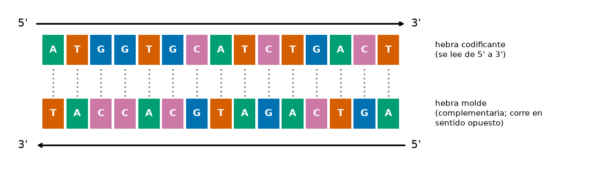
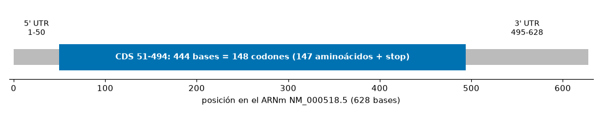
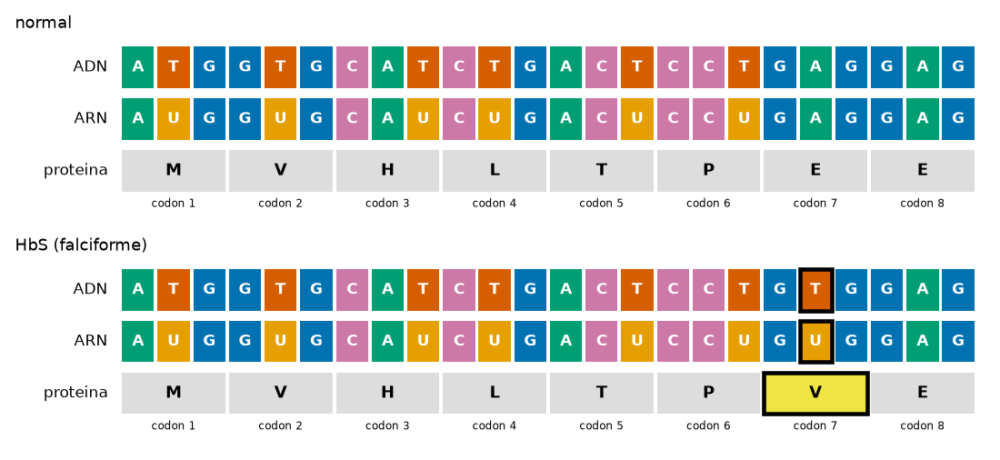

## Objetivos de aprendizaje

Al terminar esta lección podrás:

- **Explicar** qué es Biopython (una librería de dominio para biología) y por qué un `Seq` es texto con métodos de biología. *(Comprender)*
- **Operar** un `Seq` como una cadena y **obtener** sus dos hebras con `complement()` y `reverse_complement()`. *(Aplicar)*
- **Transcribir** (`transcribe()`) y **traducir** (`translate()`: codones, inicio, stop y `to_stop`). *(Aplicar)*
- **Obtener** un registro real de NCBI (`Entrez.efetch`, o una copia guardada), **leerlo** con `SeqIO.read` y **extraer** su región codificante (CDS). *(Aplicar / Analizar)*
- **Construir** una variante, **localizar** el cambio con una función propia y **clasificarlo** (cambio de aminoácido, sinónimo, sin sentido, corrimiento del marco). *(Analizar)*
- **Leer** varias muestras con `SeqIO.parse` y **compararlas** con una referencia. *(Aplicar / Analizar)*
- **Distinguir** el cambio molecular que calcula el código de una conclusión clínica. *(Evaluar)*

> **Dónde encaja:** después de la L24 (*Análisis de imágenes científicas*) · dentro del Módulo 3 · antes de la L26 (*Química: mendeleev y RDKit*). Hoy empieza el tramo de **librerías de dominio**: herramientas hechas para una ciencia concreta. Esta es la de **biología**.

## Por qué importa

La **anemia falciforme** es una enfermedad hereditaria de la sangre: los glóbulos rojos, normalmente redondos y flexibles, se deforman en forma de hoz, se atascan en los vasos y se rompen. Su causa es asombrosamente pequeña: **una sola letra** cambiada en el gen **HBB**, el que codifica la beta-globina, una parte de la hemoglobina. Hoy vas a comprobarlo tú con código: bajarás el gen real de una base de datos pública, lo traducirás a proteína, construirás la variante y verás exactamente qué cambia.

La pregunta que guía la lección: **¿puede un cambio en el ADN cambiar la proteína que produce un gen, y estar asociado a una enfermedad?**

Ya tienes casi todo para responderla. Una secuencia de ADN es **texto** (L12), y en la L15 escribiste a mano una función `gc` para el contenido GC; en la L16 parseaste un FASTA línea por línea. **Biopython**, la caja de herramientas de la bioinformática, empaqueta esas recetas y añade lo que una cadena no sabe hacer: aparear bases, transcribir, traducir con el código genético y leer los registros de las bases de datos. Es el mismo salto de **"a mano" a "herramienta"** que viste con el CSV manual (L19) y `read_csv` (L21).

> **Práctica (hands-on):** [Lab — Biopython: de un gen real a su proteína](l25_lab_biopython.md) ·
> [](https://colab.research.google.com/github///blob//u03_scientific_computing/l25_lab_biopython.ipynb)

## Calentamiento: una secuencia es texto

Biopython se instala con `%pip install -q biopython` y se importa por partes. Una secuencia se crea con `Seq(...)`. Esta no es inventada: son las **21 primeras bases** de la región codificante de HBB, el gen de hoy.

```python
from Bio.Seq import Seq
adn = Seq("ATGGTGCATCTGACTCCTGAG")
print(len(adn), adn[0:3], adn.count("G"))   # 21 ATG 6
```

Un `Seq` **es como una cadena** (L12): tiene `len`, se indexa, se rebana, se pega con `+` y se cuenta con `.count`. La diferencia es que además trae **métodos de biología**:

| Método / función | Qué hace |
|---|---|
| `seq.complement()` | la hebra complementaria, base por base (`A`-`T`, `C`-`G`) |
| `seq.reverse_complement()` | la hebra complementaria escrita en su propio sentido (5' a 3') |
| `seq.transcribe()` | ADN a ARN (cada `T` se vuelve `U`) |
| `seq.translate()` | codones (3 bases) a proteína (aminoácidos) |
| `gc_fraction(seq)` | fracción de bases `G` o `C` (el contenido GC); es una función de `Bio.SeqUtils`, no un método |

## Las dos hebras

El ADN es de **doble hebra**: frente a cada base está su pareja (`A` con `T`, `C` con `G`). Las dos hebras corren en **sentidos opuestos** (son *antiparalelas*), y por convención cada una se escribe en su propio sentido, de su extremo **5'** a su extremo **3'**:

{#fig-hebras fig-alt="Quince bases de la hebra codificante de HBB (ATGGTGCATCTGACT) con una flecha de 5' a 3', y debajo su hebra complementaria (TACCACGTAGACTGA) apareada base por base, con una flecha en sentido contrario."}

```python
print(adn.complement())          # TACCACGTAGACTGAGGACTC
print(adn.reverse_complement())  # CTCAGGAGTCAGATGCACCAT
```

`complement()` da la hebra de abajo tal como queda enfrente (leída de izquierda a derecha, es decir, de 3' a 5'). `reverse_complement()` da **la misma hebra** escrita en su sentido 5'->3', que es como la guardan las bases de datos. Lo necesitas, por ejemplo, cuando un gen está en la hebra opuesta del cromosoma: para leerlo hay que tomar el reverso-complemento.

## El dogma central: de ADN a proteína

El **dogma central** de la biología molecular describe cómo la información del ADN se convierte en proteína:

```{mermaid}
flowchart LR
    A["<b>ADN</b>"] -->|"transcribe()"| B["<b>ARN</b>"]
    B -->|"translate()"| C["<b>proteína</b>"]
```

En la célula, la enzima ARN polimerasa copia la hebra de abajo de la @fig-hebras, la hebra **molde**: el ARN sale complementario a ella, es decir, **igual a la hebra codificante** con `U` en lugar de `T`. Por eso `transcribe()` solo cambia cada `T` por `U`: trabaja con la hebra codificante, que es la que guardan las bases de datos. `translate()` lee el ARN en **codones** (grupos de 3 bases) y los convierte en **aminoácidos** según el **código genético**, una letra por aminoácido:

```python
arn = adn.transcribe()
print(arn)               # AUGGUGCAUCUGACUCCUGAG
print(arn.translate())   # MVHLTPE
print(adn.translate())   # MVHLTPE (directo desde el ADN)
```

Siete codones, siete aminoácidos. Biopython también traduce directo desde el ADN codificante y da lo mismo, porque usa el código genético con `T` en lugar de `U`. Dos casos especiales del código:

| Codón | Significa |
|---|---|
| `ATG` (`AUG`) | metionina (`M`) -- además marca el **inicio** de la traducción |
| `TAA`, `TAG`, `TGA` (`UAA`, `UAG`, `UGA`) | **stop** (no es un aminoácido; se muestra como `*`) |

`translate()` muestra los stops como `*` y sigue; `translate(to_stop=True)` se detiene en el **primero**. Y una advertencia: `translate()` **no busca** el `ATG`. Lee de 3 en 3 desde la posición 0, sea cual sea la primera letra.

## Un registro real: HBB en NCBI

Las secuencias públicas del mundo viven en bases de datos como **NCBI**. Cada registro tiene un **número de acceso**: el ARN mensajero de HBB es `NM_000518.5`. El `.5` es la **versión**: si alguien corrige la secuencia, la versión sube, así que pedir `NM_000518.5` garantiza que todos obtienen la misma. Biopython lo pide por internet con `Entrez` y lo lee con `SeqIO.read` (un archivo, **un** registro):

```python
from Bio import Entrez, SeqIO
Entrez.email = "tu_correo@ejemplo.com"
with Entrez.efetch(db="nucleotide", id="NM_000518.5",
                   rettype="gb", retmode="text") as respuesta:
    texto = respuesta.read()
with open("hbb.gb", "w") as f:
    f.write(texto)

hbb = SeqIO.read("hbb.gb", "genbank")
print(hbb.annotations["organism"], len(hbb.seq))   # Homo sapiens 628
```

Aunque es un ARN mensajero, NCBI lo guarda escrito con `T` (como su copia de ADN, el *ADNc*), y por eso se puede traducir directo. El formato **GenBank** (`.gb`) trae la secuencia **y sus anotaciones**: el organismo, el gen y una lista de regiones (`hbb.features`), cada una con su tipo, su ubicación y sus notas. La más importante es el **CDS** (*coding sequence*), la parte que de verdad se traduce. Un ARN mensajero tiene, antes y después del CDS, regiones que **no** se traducen (las *UTR*):

{#fig-transcrito fig-alt="Barra horizontal de 628 bases: un tramo gris corto al inicio (5' UTR, 1-50), un bloque azul largo (CDS, 51-494, 444 bases = 148 codones) y un tramo gris al final (3' UTR, 495-628)."}

Si tradujeras el ARNm completo desde la base 1, leerías la 5' UTR con un marco equivocado: las primeras 60 bases dan `TFASDTTVFTSNLKQTPWCI`, una "proteína" que no existe. Por eso primero se **extrae** el CDS:

```python
for f in hbb.features:
    if f.type == "CDS":
        cds_hbb = f
cds = cds_hbb.extract(hbb.seq)
proteina = cds.translate(to_stop=True)
print(len(cds), len(proteina), proteina[:10])   # 444 147 MVHLTPEEKS
```

La proteína empieza por `MVHLTPE` (tu calentamiento) y coincide letra por letra con la traducción que el propio NCBI anota en el registro.

## Una letra, otra proteína: la hemoglobina falciforme

En la anemia falciforme cambia **una base** del CDS de HBB: la de índice 19 (en Python), en el **codón 7**, que pasa de `GAG` a `GTG`. Construir la variante es rebanar y pegar, como con cadenas:

```python
hbs = cds[:19] + "T" + cds[20:]
print(cds[18:21], cds[18:21].translate())   # GAG E
print(hbs[18:21], hbs[18:21].translate())   # GTG V
```

{#fig-codones fig-alt="Dos paneles con el ADN, el ARN y la proteína de los primeros 8 codones de HBB. En la variante falciforme (HbS) la base central del codón 7 cambia de A a T (U en el ARN) y el aminoácido E (ácido glutámico) pasa a V (valina), marcado en amarillo."}

El ácido glutámico (`E`) se vuelve **valina** (`V`). La valina es hidrofóbica: cuando la hemoglobina suelta el oxígeno, las moléculas con valina se pegan entre sí en fibras largas que deforman el glóbulo rojo. En el lab, una función `diferencias` compara las dos proteínas posición por posición y encuentra el cambio sin saber de antemano dónde mirar.

**¿Codón 7 o "Glu6Val"?** En los libros verás esta mutación como **Glu6Val** (o E6V). El nombre clásico cuenta los aminoácidos **sin** la metionina inicial, que la célula retira de la proteína madura; en el CDS es el codón 7. Es el mismo cambio contado desde otro punto de partida, como el índice 0 de Python frente a la "posición 1" de la biología. Ojo: es una convención histórica de la hemoglobina. La nomenclatura moderna (HGVS) sí cuenta la metionina y escribe `p.Glu7Val`, y la F508 de la CFTR (Caso 2) también es el codón 508 contando desde el `ATG`. Las estructuras 3D del *Protein Data Bank* usan la numeración clásica: en la hemoglobina falciforme (`2HBS`) el residuo 6 de cada cadena beta es valina; en la normal (`2HHB`), ácido glutámico.

## Tipos de mutación

Con el mismo codón 7 de HBB se ven las clases de cambio más comunes:

| Tipo | Cambio en el ADN | Efecto en la proteína |
|---|---|---|
| **Cambio de aminoácido** (*missense*) | `GAG` -> `GTG` | `E` -> `V` en la posición 7 (la HbS) |
| **Sinónimo** (silencioso) | `GAG` -> `GAA` | ninguno: `GAA` también es `E` (hay varios codones por aminoácido) |
| **Sin sentido** (*nonsense*) | `GAG` -> `TAG` | aparece un stop: la proteína se corta en `MVHLTP` (6 aminoácidos) |
| **Corrimiento del marco** | se borra la base de índice 19 | los codones siguientes se leen corridos: `MVHLTPGRSLPLLPCGAR` y un stop (18 aminoácidos en vez de 147) |

El último caso muestra por qué importa el **marco de lectura**: borrar o insertar un número de bases que **no** es múltiplo de 3 desplaza todos los codones siguientes. Borrar exactamente 3 bases, en cambio, quita un aminoácido y deja el resto igual: lo verás en el Caso 2.

## Contenido GC

El **contenido GC** es el porcentaje de bases que son `G` o `C`: lo que calculaba la función `gc` que escribiste en la L15, ahora empaquetado en `gc_fraction`, que da la fracción (de 0 a 1):

```python
from Bio.SeqUtils import gc_fraction
print(round(gc_fraction(adn) * 100, 1))   # 52.4
```

Se mide porque los pares `G`-`C` se unen con tres puentes de hidrógeno (y se apilan con más fuerza) y los `A`-`T` con dos: un ADN rico en GC necesita más temperatura para separar sus hebras, algo que se tiene en cuenta, por ejemplo, al diseñar los cebadores de una PCR. Un cambio de una sola base casi no lo mueve (en el lab, 56.1 % frente a 55.9 %): para encontrar una mutación hay que comparar las secuencias, no los promedios.

## Leer muestras con `SeqIO.parse`

En la **L16** parseaste un FASTA a mano, distinguiendo las líneas de encabezado (`>`) de las de secuencia. `SeqIO.parse` lo hace en **una llamada** y entrega un **registro** por secuencia, aunque cada una ocupe varias líneas:

```python
for registro in SeqIO.parse("muestras.fasta", "fasta"):
    prot = registro.seq.translate(to_stop=True)
    print(registro.id, len(prot))
```

| FASTA en la L16 (a mano) | FASTA en la L25 (Biopython) |
|---|---|
| abrir el archivo, recorrer líneas | `SeqIO.parse('muestras.fasta', 'fasta')` |
| `if linea.startswith('>')` separar encabezado | cada `registro` ya viene separado (`registro.id`) |
| juntar las líneas de secuencia | `registro.seq` (un objeto `Seq`, listo) |

`SeqIO.read` es para un archivo con **un** registro (como el GenBank de HBB); `SeqIO.parse`, para recorrer **varios**. En el lab, cuatro muestras de laboratorio (ficticias, construidas a partir del gen real) se comparan con la referencia y se clasifican según la tabla de tipos de mutación.

## Límites: lo que el código puede y no puede decir

::: {.callout-important}
## El código calcula el cambio molecular, no un diagnóstico

- Lo que **calculamos** es el cambio en la secuencia y en la proteína codificada. Lo que ese cambio **significa** para la salud viene de evidencia curada: estudios de laboratorio y clínicos, reunidos en bases de datos como ClinVar.
- Cada persona tiene **dos copias** de HBB, una de cada progenitor. Con una copia HbS y una normal se tiene el **rasgo falciforme**, que por lo general no causa la enfermedad; la anemia falciforme aparece con **dos** copias HbS; HbS junto a ciertas otras variantes de HBB (como la HbC o una beta-talasemia) también causa una forma de *enfermedad de células falciformes*.
- Una diferencia en una secuencia **no es un diagnóstico**: el diagnóstico lo hace un profesional de la salud con pruebas clínicas.
- En clase se usan secuencias públicas de referencia y muestras **ficticias**. Los datos genéticos personales son información sensible: no se comparten ni se suben a herramientas en línea.
:::

## Caso 2 (opcional): fibrosis quística

La variante más común de la **fibrosis quística**, **F508del**, borra 3 bases del gen **CFTR**, que produce un canal de cloruro de las células. Con las mismas herramientas (registro `NM_000492.4`, su CDS de 4443 bases) se ve que la proteína pasa de 1480 a 1479 aminoácidos: falta la fenilalanina 508 (`F`), de ahí el nombre. Comparar posición por posición, como hace `diferencias`, falla aquí: después de la deleción todo queda corrido una posición. Y si se borrara **una** sola base, el marco de lectura se correría y la proteína quedaría en 525 aminoácidos. El lab trae este caso completo para leerlo y correrlo por tu cuenta (no es materia de examen).

> **Límites del Caso 2:** F508del es una de más de mil variantes conocidas de CFTR. La fibrosis quística aparece cuando las **dos** copias del gen tienen variantes que causan la enfermedad, y el diagnóstico usa pruebas clínicas (como la del sudor) además de la secuencia.

## La hemoglobina en 3D

La secuencia termina en una molécula. El **Protein Data Bank** guarda estructuras 3D medidas en el laboratorio; puedes girar la hemoglobina normal ([2HHB](https://www.rcsb.org/structure/2HHB)) y la falciforme ([2HBS](https://www.rcsb.org/structure/2HBS)) en el visor de RCSB. El lab trae una celda opcional que las muestra en Colab con la librería **py3Dmol** (no es materia de examen).

## Preguntas frecuentes

**"¿`Seq` o una cadena normal?"** — Para texto cualquiera, una cadena. Para una **secuencia biológica** que vas a complementar, transcribir o traducir, un `Seq`: trae esos métodos y se comporta como una cadena para `len`, indexar, rebanar, `+` y `count`.

**"¿`translate()` o `translate(to_stop=True)`?"** — `translate()` traduce toda la secuencia y muestra los stops como `*`. `translate(to_stop=True)` se detiene en el **primer** stop y no lo incluye: es la proteína que de verdad se produce desde el inicio.

**"¿Por qué el codón 7 si la mutación se llama Glu6Val?"** — Porque el nombre clásico de la hemoglobina cuenta los aminoácidos sin la metionina inicial, que la célula retira de la proteína madura. En el CDS (y en Python) se cuenta desde el `ATG`, igual que en la nomenclatura moderna (`p.Glu7Val`).

**"¿Y si NCBI no responde?"** — El lab trae un plan B: una copia del mismo registro (`NM_000518.5`) guardada en el repositorio del curso. Como el número de acceso incluye la versión, la copia y la descarga son la misma secuencia.

**"¿Toda mutación importante cambia la proteína?"** — No. Algunas variantes caen fuera del CDS y cambian **cuánto** se produce de una proteína, no su secuencia. Un ejemplo conocido es la persistencia de la lactasa (poder digerir la leche de adulto). Traducir esa región no explicaría nada: hace falta otro tipo de análisis.

## Para reflexionar

Practica y discute (en clase o por escrito):

1. ¿Por qué `reverse_complement()` no es lo mismo que `complement()`? Si un gen está en la hebra opuesta del cromosoma, ¿cuál de los dos usarías para leerlo?
2. Una secuencia codificante tiene 300 bases contando el stop. ¿Cuántos codones tiene? ¿Cuántos aminoácidos esperarías de `translate(to_stop=True)`?
3. Traducir el ARNm completo de HBB desde la base 1 da `TFASDTTVFTSNLKQTPWCI`. ¿Por qué no sale la beta-globina?
4. En el Paso 6 del lab, la muestra 4 da `cambios: []` pero solo 6 aminoácidos. ¿Qué te dice eso de la función `diferencias` y de cómo leer su resultado?
5. Una persona tiene una copia HbS del gen HBB. ¿Qué puede afirmar el código y qué no?

## Resumen

| Idea clave | En una frase |
|------------|--------------|
| Biopython | librería de dominio para biología; `%pip install -q biopython` |
| `Seq` | una secuencia es texto (`len`, indexar, rebanar, `+`, `count`) con métodos de biología |
| Dos hebras | `complement()` aparea; `reverse_complement()` es la otra hebra en su sentido 5'->3' |
| Dogma central | `transcribe()` (ADN->ARN) y `translate()` (codones->proteína; `*` = stop; `to_stop`) |
| Datos reales | `Entrez.efetch` (NCBI, número de acceso con versión) + `SeqIO.read(..., 'genbank')` |
| CDS | solo se traduce la región codificante: `f.type == 'CDS'`, `f.extract(...)` |
| Mutaciones | cambio de aminoácido, sinónima, sin sentido, corrimiento del marco |
| HbS | `GAG`->`GTG` en el codón 7 de HBB: `E`->`V` ("Glu6Val" en la numeración clásica) |
| Varias muestras | `SeqIO.parse('archivo.fasta', 'fasta')`: un registro por secuencia (espiral de la L16) |
| Límites | el código calcula el cambio molecular; el diagnóstico es clínico |

## Para profundizar

- **Texto del curso (código abierto):** *Introducción a la programación con Python 3* (Marzal, Gracia y García, UJI/Sapientia, licencia CC).
- **Documentación oficial:** el *Biopython Tutorial and Cookbook* (`biopython.org`), en particular los capítulos de `Seq`, `SeqIO` y `Entrez`.
- **Las bases de datos de hoy:** el registro [NM_000518.5](https://www.ncbi.nlm.nih.gov/nuccore/NM_000518.5) en NCBI; ClinVar (`ncbi.nlm.nih.gov/clinvar`) para el significado clínico de las variantes; el visor de estructuras de RCSB PDB (`rcsb.org`).
- **Fuentes de los datos:** registros RefSeq `NM_000518.5` (HBB) y `NM_000492.4` (CFTR) de NCBI (NIH), de uso libre; estructuras `2HHB` y `2HBS` del RCSB PDB (CC0). Las cuatro muestras del lab son **ficticias**: el curso las construyó a partir del CDS real de HBB.
- **Más allá de esta lección:** Biopython también **alinea** secuencias (la forma correcta de comparar cuando hay inserciones o deleciones, como en el Caso 2), busca con BLAST y construye árboles filogenéticos. Todo parte de la idea de hoy: *una secuencia es un dato, y la librería de dominio le da sus operaciones*. En la **L26** verás la librería de dominio de **química** (mendeleev y RDKit): la tabla periódica como datos.
