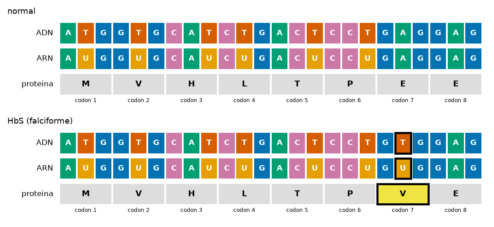

# Lab: Biopython -- de un gen real a su proteína

**Meta:** investigar con código una pregunta real: **¿puede el cambio de una sola letra del ADN cambiar la proteína que produce un gen?** Trabajarás con el gen **HBB**, el de la beta-globina (una parte de la hemoglobina), y con la mutación que causa la **anemia falciforme**. Primero un calentamiento con las 21 primeras bases del gen; luego bajarás el registro **real** de NCBI, sacarás su región codificante, construirás la variante falciforme, **localizarás** el cambio con una función tuya, lo **dibujarás** y clasificarás cuatro muestras de laboratorio. Acompaña a la nota de concepto [Biopython](l25_concept_biopython.qmd).

> **Cómo usar este lab:** ejecuta cada celda con `Shift + Enter`, empezando por las dos celdas de preparación. El Paso 2 baja el gen de NCBI por internet (**Opción A**); si esa celda da error, corre la **Opción B**, que baja una copia guardada en el repositorio del curso, y sigue. Donde diga **Predice**, piensa primero qué pasaría y después ejecuta la celda; la respuesta está en el bloque desplegable que le sigue. En **Tu turno**, el Ejercicio 1 trae un bloque comentado con una parte marcada con `____` que debes **completar** al quitar los `#`; el Ejercicio 2 (opcional) lo escribes tú. **Tiempo sugerido (80 min):** Preparación, 3 min; Paso 1, 12 min; Paso 2, 6 min; Paso 3, 12 min; Paso 4, 12 min; Paso 5, 5 min; Paso 6, 12 min; Tu turno, 13 min. El Paso 7 y el **Caso 2** son **opcionales**: en clase si sobra tiempo, si no en casa.
>
> [](https://colab.research.google.com/github/devomh/comp3005-2026/blob/main/u03_scientific_computing/l25_lab_biopython.ipynb)

## Preparación

Necesitamos **Biopython**, la librería de bioinformática de Python (se importa como `Bio`). Corre estas **dos** celdas primero. La primera la instala (en Colab; si ya está, no hace nada). La segunda importa lo que usaremos y baja, si todavía no lo tienes, un archivo FASTA con cuatro muestras que el curso preparó para el Paso 6.

```python
%pip install -q biopython
```

```python
from pathlib import Path
from urllib.request import urlretrieve
from Bio.Seq import Seq
from Bio import SeqIO, Entrez
from Bio.SeqUtils import gc_fraction
import matplotlib.pyplot as plt

# Muestras del Paso 6 (un archivo del repositorio del curso).
MUESTRAS = "secuencias/l25_muestras_hbb.fasta"
URL_MUESTRAS = "https://raw.githubusercontent.com/devomh/comp3005-2026/main/u03_scientific_computing/secuencias/l25_muestras_hbb.fasta"
Path("secuencias").mkdir(exist_ok=True)
if not Path(MUESTRAS).exists():   # en Colab: descargar
    urlretrieve(URL_MUESTRAS, MUESTRAS)

print("Biopython listo; muestras en", MUESTRAS)
```

~~~text
Biopython listo; muestras en secuencias/l25_muestras_hbb.fasta
~~~

## Paso 1: calentamiento -- una secuencia es texto

Una secuencia de ADN es **texto**: una cadena de las letras `A`, `C`, `G`, `T`. Con `Seq(...)` la creamos como un objeto de Biopython. Esta no es inventada: son las **21 primeras bases** del gen HBB, el que estudiaremos hoy. Un `Seq` es **como una cadena** (lo de la L12): tiene `len`, se indexa, se rebana y se cuenta con `.count`.

```python
adn = Seq("ATGGTGCATCTGACTCCTGAG")
print("secuencia:", adn)
print("longitud:", len(adn))
print("primer codon:", adn[0:3])
print("conteo de G:", adn.count("G"))
```

~~~text
secuencia: ATGGTGCATCTGACTCCTGAG
longitud: 21
primer codon: ATG
conteo de G: 6
~~~

Son 21 bases, o sea **7 codones** (grupos de 3). Empieza por `ATG`, el codón de inicio de casi todos los genes.

El ADN es de **doble hebra**: frente a cada base está su pareja (`A` con `T`, `C` con `G`), y las dos hebras corren en **sentidos opuestos** (se dice que son *antiparalelas*). Por convención, toda hebra se escribe en su propio sentido, de su extremo **5'** a su extremo **3'**. `complement()` aparea base por base, en el mismo orden; `reverse_complement()` da la otra hebra **escrita en su sentido**, de 5' a 3'.

**Predice:** ¿cuáles serán las tres primeras letras de `adn.reverse_complement()`?

```python
print("hebra:              ", adn)
print("complemento:        ", adn.complement())
print("reverso-complemento:", adn.reverse_complement())
```

~~~text
hebra:               ATGGTGCATCTGACTCCTGAG
complemento:         TACCACGTAGACTGAGGACTC
reverso-complemento: CTCAGGAGTCAGATGCACCAT
~~~

<details><summary>Respuesta</summary>

`CTC`: el reverso-complemento empieza por el **final** de la hebra original (`...GAG`), complementado (`G->C`, `A->T`, `G->C`) y leído al revés. Fíjate en que el complemento, leído de derecha a izquierda, es exactamente el reverso-complemento. Es la misma hebra opuesta: una vez escrita "tal como queda enfrente" y otra vez escrita en su propio sentido 5'->3', que es como la guardan las bases de datos. La necesitas, por ejemplo, cuando un gen está en la hebra opuesta del cromosoma.
</details>

Ahora el **dogma central**. En la célula, la enzima ARN polimerasa copia la hebra complementaria (la hebra **molde**), así que el ARN sale **igual a la hebra codificante**, la nuestra, con `U` en lugar de `T`. Por eso `transcribe()` solo cambia cada `T` por `U`. Luego `translate()` lee el ARN en **codones** y los traduce a **aminoácidos**, una letra por aminoácido.

```python
arn = adn.transcribe()
print("ARN:     ", arn)
print("proteina:", arn.translate())
print("traducido desde el ADN:", adn.translate())
```

~~~text
ARN:      AUGGUGCAUCUGACUCCUGAG
proteina: MVHLTPE
traducido desde el ADN: MVHLTPE
~~~

Siete codones, siete aminoácidos: `M` (metionina, el inicio `AUG`), `V`, `H`, `L`, `T`, `P` y `E` (ácido glutámico). Biopython también traduce directo desde el ADN codificante y da lo mismo, porque usa el mismo código genético con `T` en vez de `U`. Recuerda esa última `E`, la del **codón 7**: es la protagonista de hoy.

## Paso 2: obtener el registro real de HBB en NCBI

**NCBI** (el Centro Nacional de Información Biotecnológica de EE. UU.) guarda las secuencias públicas del mundo. Cada registro tiene un **número de acceso**: el ARN mensajero de HBB en la colección de referencia *RefSeq* es `NM_000518.5`. El `.5` es la **versión**: si alguien corrige la secuencia, la versión sube, así que pedir `NM_000518.5` garantiza que todos obtienen exactamente la misma.

**Opción A (por internet).** `Entrez.efetch` le pide el registro a NCBI en formato **GenBank** (`rettype="gb"`), un archivo de texto con la secuencia y sus **anotaciones**. NCBI pide un correo para saber quién consulta: pon el tuyo.

```python
Entrez.email = "tu_correo@ejemplo.com"   # pon tu correo
with Entrez.efetch(db="nucleotide", id="NM_000518.5",
                   rettype="gb", retmode="text") as respuesta:
    texto = respuesta.read()
with open("hbb.gb", "w") as f:
    f.write(texto)
print("hbb.gb guardado desde NCBI")
```

~~~text
hbb.gb guardado desde NCBI
~~~

**Opción B (plan B).** Si la celda anterior dio error (sin internet, NCBI ocupado), esta baja una copia del mismo registro guardada en el repositorio del curso. Si la Opción A funcionó, no hace nada.

```python
URL_HBB = "https://raw.githubusercontent.com/devomh/comp3005-2026/main/u03_scientific_computing/secuencias/l25_hbb_NM_000518.5.gb"
if not Path("hbb.gb").exists():
    urlretrieve(URL_HBB, "hbb.gb")
print("hbb.gb listo:", Path("hbb.gb").exists())
```

~~~text
hbb.gb listo: True
~~~

> **Buena práctica:** NCBI permite unas pocas consultas por segundo. Baja cada registro **una vez**, guárdalo en un archivo y trabaja con el archivo, como aquí. *(Fuente: NCBI RefSeq `NM_000518.5`, NIH, datos de uso libre.)*

## Paso 3: leer el registro y sacar la región codificante

Un archivo GenBank trae **un** registro, así que se lee con `SeqIO.read` (en el Paso 6, `SeqIO.parse` recorrerá **varios**; en la L16 lo hiciste a mano). El registro guarda la secuencia y lo que se sabe de ella: el organismo, el gen y sus regiones.

```python
hbb = SeqIO.read("hbb.gb", "genbank")
print("id:", hbb.id)
print("descripcion:", hbb.description)
print("organismo:", hbb.annotations["organism"])
print("longitud:", len(hbb.seq), "bases")
```

~~~text
id: NM_000518.5
descripcion: Homo sapiens hemoglobin subunit beta (HBB), mRNA
organismo: Homo sapiens
longitud: 628 bases
~~~

Aunque es un ARN mensajero, NCBI lo guarda escrito con `T` (como su copia de ADN, el *ADNc*), y por eso se puede traducir directo.

Las **anotaciones** de regiones están en `hbb.features`, una lista. Son muchas, así que las contamos por tipo con la tabla de frecuencias de la L14:

```python
conteo = {}
for f in hbb.features:
    conteo[f.type] = conteo.get(f.type, 0) + 1
for tipo in conteo:
    print(tipo, conteo[tipo])
```

~~~text
source 1
gene 1
exon 3
misc_feature 38
CDS 1
mat_peptide 2
regulatory 1
polyA_site 1
~~~

Casi todas son `misc_feature` (notas sobre posiciones puntuales). Las que nos importan son los exones y el CDS:

```python
for f in hbb.features:
    if f.type == "exon" or f.type == "CDS":
        print(f.type, f.location)
```

~~~text
exon [0:142](+)
CDS [50:494](+)
exon [142:365](+)
exon [365:628](+)
~~~

Hay **3 exones** (en el cromosoma el gen tiene intrones entre ellos; este ARN mensajero ya viene "empalmado") y **un CDS** (*coding sequence*): la región que de verdad se traduce. `[50:494]` está en notación de Python (desde 0, sin incluir el final): en biología se dice "de la base 51 a la 494". El `(+)` indica la hebra.

**Predice:** ¿qué pasa si traducimos el ARN mensajero desde su primera base, sin buscar el CDS?

```python
print(hbb.seq[0:60].translate())
```

~~~text
TFASDTTVFTSNLKQTPWCI
~~~

<details><summary>Respuesta</summary>

Sale una "proteína" que no existe: no empieza por `M` y no se parece en nada a la beta-globina. `translate()` no busca el codón de inicio: lee de 3 en 3 **desde la posición 0**, y aquí la posición 0 cae en la región **5' UTR** (la parte inicial del ARNm que no se traduce), con un marco de lectura equivocado. Por eso hay que sacar primero el CDS.
</details>

Buscamos el CDS con un `for` y un `if`, y lo sacamos con `extract`, que recorta del registro justo esa región:

```python
for f in hbb.features:
    if f.type == "CDS":
        cds_hbb = f
cds = cds_hbb.extract(hbb.seq)
proteina = cds.translate(to_stop=True)
print("gen:", cds_hbb.qualifiers["gene"][0])
print("CDS:", len(cds), "bases")
print("proteina:", len(proteina), "aminoacidos")
for i in range(0, len(proteina), 50):
    print(proteina[i:i+50])
print("igual a la de NCBI:", proteina == cds_hbb.qualifiers["translation"][0])
```

~~~text
gen: HBB
CDS: 444 bases
proteina: 147 aminoacidos
MVHLTPEEKSAVTALWGKVNVDEVGGEALGRLLVVYPWTQRFFESFGDLS
TPDAVMGNPKVKAHGKKVLGAFSDGLAHLDNLKGTFATLSELHCDKLHVD
PENFRLLGNVLVCVLAHHFGKEFTPPVQAAYQKVVAGVANALAHKYH
igual a la de NCBI: True
~~~

444 bases son 148 codones: 147 aminoácidos y el codón de stop (`to_stop=True` lo deja fuera). La proteína empieza por `MVHLTPE`, ¡tu calentamiento!, y coincide letra por letra con la traducción que NCBI anota en el registro (`qualifiers` es un diccionario con las notas de la región). Veamos los primeros 8 codones:

```python
for k in range(8):
    print("codon", k + 1, cds[3*k:3*k+3], proteina[k])
```

~~~text
codon 1 ATG M
codon 2 GTG V
codon 3 CAT H
codon 4 CTG L
codon 5 ACT T
codon 6 CCT P
codon 7 GAG E
codon 8 GAG E
~~~

## Paso 4: construir la variante falciforme y localizar el cambio

En la anemia falciforme, **una sola base** del gen HBB cambia: en el codón 7, `GAG` pasa a `GTG`. El codón 7 ocupa las bases 18, 19 y 20 (índices de Python), así que la base que cambia es la de índice **19**. Construimos la variante rebanando y pegando, como con cadenas en la L12:

```python
hbs = cds[:19] + "T" + cds[20:]
print("codon 7 normal:", cds[18:21], "->", cds[18:21].translate())
print("codon 7 HbS:   ", hbs[18:21], "->", hbs[18:21].translate())
proteina_hbs = hbs.translate(to_stop=True)
print("longitudes:", len(proteina), len(proteina_hbs))
```

~~~text
codon 7 normal: GAG -> E
codon 7 HbS:    GTG -> V
longitudes: 147 147
~~~

Ácido glutámico (`E`) pasa a valina (`V`). En una proteína de 147 aminoácidos ese cambio es fácil de ver aquí porque sabemos dónde mirar. ¿Y si no lo supiéramos? Escribimos una **función** (L15) que compare dos proteínas posición por posición y devuelva una **lista** (L13) con las posiciones distintas. Las contamos desde 1, como en biología:

```python
def diferencias(p1, p2):
    n = len(p1)
    if len(p2) < n:      # comparar solo hasta la mas corta
        n = len(p2)
    posiciones = []
    for i in range(n):
        if p1[i] != p2[i]:
            posiciones.append(i + 1)
    return posiciones

cambios = diferencias(proteina, proteina_hbs)
print("posiciones distintas:", cambios)
for p in cambios:
    print("aminoacido", p, ":", proteina[p - 1], "->", proteina_hbs[p - 1])
```

~~~text
posiciones distintas: [7]
aminoacido 7 : E -> V
~~~

Un solo cambio, en el aminoácido 7. Si buscas la anemia falciforme en un libro, la verás como **"Glu6Val"** (o E6V): el nombre clásico de la hemoglobina cuenta los aminoácidos **sin** la metionina inicial, que la célula quita de la proteína madura. Es el mismo cambio contado desde otro punto de partida, igual que el índice 0 de Python frente a la "posición 1" de la biología. Es una convención histórica: la nomenclatura moderna sí cuenta la metionina (`p.Glu7Val`).

## Paso 5: ver el cambio

Esta celda define una función de ayuda, `dibujar_codones`, que dibuja el ADN, el ARN y la proteína alineados por codón y marca lo que cambió. **No hace falta entender su código** (usa matplotlib, de la L23): basta con usarla.

```python
COLORES = {"A": "#009E73", "T": "#D55E00", "U": "#E69F00",
           "G": "#0072B2", "C": "#CC79A7"}

def dibujar_codones(normal, variante, titulo, n_codones=8):
    n = 3 * n_codones
    prot_normal = normal[:n].translate()
    fig, ejes = plt.subplots(2, 1, figsize=(10, 4.6))
    for eje, nombre, adn in [(ejes[0], "normal", normal), (ejes[1], titulo, variante)]:
        arn = adn[:n].transcribe()
        prot = adn[:n].translate()
        for i in range(n):
            borde = 3 if adn[i] != normal[i] else 0
            for fila, letra in [(2, adn[i]), (1, arn[i])]:
                eje.add_patch(plt.Rectangle((i, fila), 0.9, 0.8, facecolor=COLORES[letra],
                                            edgecolor="black", linewidth=borde))
                eje.text(i + 0.45, fila + 0.4, letra, ha="center", va="center",
                         color="white", fontsize=11, fontweight="bold")
        for k in range(n_codones):
            cambio = prot[k] != prot_normal[k]
            fondo = "#F0E442" if cambio else "#DDDDDD"
            eje.add_patch(plt.Rectangle((3 * k, 0), 2.9, 0.8, facecolor=fondo,
                                        edgecolor="black", linewidth=3 if cambio else 0))
            eje.text(3 * k + 1.45, 0.4, prot[k], ha="center", va="center",
                     fontsize=12, fontweight="bold")
            eje.text(3 * k + 1.45, -0.3, "codon " + str(k + 1), ha="center", fontsize=8)
        for fila, etiqueta in [(2, "ADN"), (1, "ARN"), (0, "proteina")]:
            eje.text(-0.4, fila + 0.4, etiqueta, ha="right", va="center", fontsize=11)
        eje.set_title(nombre, loc="left")
        eje.set_xlim(-3, n + 0.2)
        eje.set_ylim(-0.6, 3)
        eje.axis("off")
    plt.tight_layout()
    plt.show()
```

```python
dibujar_codones(cds, hbs, "HbS (falciforme)")
```

{fig-alt="Dos paneles con el ADN, el ARN y la proteína de los primeros 8 codones de HBB. En la variante falciforme la base central del codón 7 cambia de A a T (U en el ARN) y el aminoácido E pasa a V, marcado en amarillo."}

Una letra de 444 cambia un aminoácido de 147. La valina, a diferencia del ácido glutámico, es hidrofóbica: cuando la hemoglobina suelta el oxígeno, las moléculas con valina se pegan entre sí en fibras largas que deforman el glóbulo rojo en forma de hoz. El código calcula el **cambio molecular**; lo que ese cambio hace en el cuerpo viene de décadas de investigación de laboratorio y clínica.

## Paso 6: cuatro muestras de laboratorio

Un laboratorio te manda un FASTA con la región codificante de HBB de **cuatro muestras** (ficticias: el curso las construyó a partir del CDS real). Cada secuencia ocupa varias líneas, como en los FASTA de verdad; `SeqIO.parse` las junta por ti y entrega un registro por muestra. Para cada una comparamos el ADN con la referencia, la longitud de la proteína y las posiciones distintas:

```python
for registro in SeqIO.parse(MUESTRAS, "fasta"):
    prot = registro.seq.translate(to_stop=True)
    print(registro.id, "| ADN igual:", registro.seq == cds,
          "| aminoacidos:", len(prot),
          "| cambios:", diferencias(proteina, prot),
          "| GC%:", round(gc_fraction(registro.seq) * 100, 1))
```

~~~text
muestra_1 | ADN igual: False | aminoacidos: 147 | cambios: [] | GC%: 55.9
muestra_2 | ADN igual: False | aminoacidos: 147 | cambios: [7] | GC%: 56.1
muestra_3 | ADN igual: True | aminoacidos: 147 | cambios: [] | GC%: 56.1
muestra_4 | ADN igual: False | aminoacidos: 6 | cambios: [] | GC%: 55.9
~~~

**Clasifica:** lee la salida y clasifica cada muestra: ¿igual a la referencia, cambio de aminoácido, cambio **sinónimo** (el ADN cambia pero la proteína no) o **sin sentido** (aparece un stop antes de tiempo)?

<details><summary>Respuesta</summary>

- **muestra_3:** igual a la referencia (el ADN es idéntico).
- **muestra_2:** cambio de aminoácido en la posición 7: es la variante falciforme (HbS).
- **muestra_1:** **sinónima**: el ADN es distinto pero la proteína tiene 147 aminoácidos sin cambios. El codón 7 pasó de `GAG` a `GAA`, que también codifica ácido glutámico (el código genético tiene varios codones por aminoácido).
- **muestra_4:** **sin sentido**: `cambios` sale vacío, ¡pero la proteína tiene solo 6 aminoácidos! El codón 7 pasó a `TAG`, un stop, y la proteína se corta en `MVHLTP`. Por eso `diferencias` no basta: compara solo hasta la más corta, y hay que mirar también la longitud.

El **contenido GC** (`gc_fraction`, la función `gc` que escribiste a mano en la L15, ya empaquetada) apenas se mueve: 56.1 % en la referencia y la HbS (`A->T` no cambia el número de G o C), 55.9 % en las otras dos (una `G` se volvió `A` o `T`). Un cambio de una base casi no altera el GC; para encontrarlo hay que comparar las secuencias.
</details>

## Tu turno

### Ejercicio 1: otra variante real, la HbC

La **hemoglobina C** es otra variante real del mismo codón 7: `GAG` pasa a `AAG`, es decir, cambia la **primera** base del codón. Construye la variante, tradúcela y localiza el cambio. Para eso tienes que averiguar qué **índice de Python** tiene la primera base del codón 7 (en el Paso 4, la HbS cambiaba la segunda, la de índice 19). Completa los tres `____` y después responde: **¿qué tipo de cambio es y por qué?**

```python
# TODO: quita los # y completa los ____ (dos indices y la base nueva).
# hbc = cds[:____] + "____" + cds[____:]
# proteina_hbc = hbc.translate(to_stop=True)
# print("codon 7:", hbc[18:21], "->", hbc[18:21].translate())
# print("aminoacidos:", len(proteina_hbc))
# print("cambios:", diferencias(proteina, proteina_hbc))
```

<details><summary>Respuesta esperada</summary>

El codón 7 ocupa los índices 18, 19 y 20 (el codón número `k` empieza en el índice `3 * (k - 1)`), así que su primera base es la de índice **18**; se conserva todo hasta el 18 sin incluirlo, se pone la base nueva `"A"` y se sigue desde el 19:

~~~python
hbc = cds[:18] + "A" + cds[19:]
proteina_hbc = hbc.translate(to_stop=True)
print("codon 7:", hbc[18:21], "->", hbc[18:21].translate())
print("aminoacidos:", len(proteina_hbc))
print("cambios:", diferencias(proteina, proteina_hbc))
~~~

~~~text
codon 7: AAG -> K
aminoacidos: 147
cambios: [7]
~~~

Es un **cambio de aminoácido** (*missense*): la proteína conserva sus 147 aminoácidos (no hay stop prematuro), pero `diferencias` encuentra uno distinto, el 7, donde el ácido glutámico (`E`) pasa a **lisina** (`K`). Mismo codón que la HbS, otra letra, otra proteína: en un libro la verás como "Glu6Lys".
</details>

### Ejercicio 2 (opcional): una función que clasifica

Escribe una función `clasificar(adn_muestra)` que devuelva el tipo de cambio respecto a la referencia (`cds`, `proteina`): "igual a la referencia", "sinonima", "sin sentido" o "cambio de aminoacido". Usa `if`/`elif`/`else` (L06-L07) y lo que viste en el Paso 6. Pruébala con las cuatro muestras y con `hbc`.

<details><summary>Una solución posible</summary>

~~~python
def clasificar(adn_muestra):
    prot = adn_muestra.translate(to_stop=True)
    if adn_muestra == cds:
        return "igual a la referencia"
    elif prot == proteina:
        return "sinonima"
    elif len(prot) < len(proteina):
        return "sin sentido"
    else:
        return "cambio de aminoacido"

for registro in SeqIO.parse(MUESTRAS, "fasta"):
    print(registro.id, "->", clasificar(registro.seq))
print("hbc ->", clasificar(hbc))
~~~

~~~text
muestra_1 -> sinonima
muestra_2 -> cambio de aminoacido
muestra_3 -> igual a la referencia
muestra_4 -> sin sentido
hbc -> cambio de aminoacido
~~~

El orden de las preguntas importa: primero "¿es idéntica?", luego "¿la proteína es la misma?" y solo después "¿es más corta?". Si preguntaras primero "¿la proteína es la misma?", la referencia también saldría como "sinonima": por eso la pregunta "¿es idéntica?" va primero.
</details>

## Paso 7 (opcional): la hemoglobina en 3D

El cambio de una letra termina en una molécula. El **Protein Data Bank** (PDB) guarda estructuras 3D medidas en el laboratorio: `2HHB` es la hemoglobina normal y `2HBS` la falciforme. Puedes explorarlas en el visor de RCSB ([2HHB](https://www.rcsb.org/structure/2HHB), [2HBS](https://www.rcsb.org/structure/2HBS)) o aquí mismo con la librería **py3Dmol** (no es materia de examen). Las dos celdas siguientes funcionan en **Colab**: allí aparece un visor que puedes girar con el ratón.

```python
%pip install -q py3Dmol
```

```python
import py3Dmol

for codigo in ["2HHB", "2HBS"]:
    vista = py3Dmol.view(query="pdb:" + codigo, width=420, height=340)
    vista.setStyle({"cartoon": {"color": "spectrum"}})
    vista.addStyle({"resi": 6, "resn": ["GLU", "VAL"]}, {"stick": {"colorscheme": "redCarbon"}})
    vista.zoomTo()
    vista.show()
```

*(Estructuras: RCSB PDB, CC0.)* En rojo, con barras, está el aminoácido 6 de cada cadena beta: ácido glutámico (`GLU`) en `2HHB` y valina (`VAL`) en `2HBS`. El PDB usa la numeración clásica (sin la metionina inicial), por eso aquí es el 6 y no el 7. El cristal de `2HBS` trae dos hemoglobinas (ocho cadenas). En la anemia falciforme, la valina de una hemoglobina encaja en una zona hidrofóbica de su vecina, y esa unión, repetida, forma las fibras que deforman el glóbulo rojo.

## Caso 2 (opcional): fibrosis quística y la deleción F508del

En la HbS **cambió** una base. Otra clase de mutación **borra** bases. La variante más común de la **fibrosis quística**, llamada **F508del**, borra 3 bases del gen **CFTR**, que produce un canal de cloruro en las células. Este caso usa exactamente las mismas herramientas. Primero bajamos el registro (Opción A por internet, Opción B la copia del curso):

```python
with Entrez.efetch(db="nucleotide", id="NM_000492.4",
                   rettype="gb", retmode="text") as respuesta:
    texto = respuesta.read()
with open("cftr.gb", "w") as f:
    f.write(texto)
print("cftr.gb guardado desde NCBI")
```

~~~text
cftr.gb guardado desde NCBI
~~~

```python
URL_CFTR = "https://raw.githubusercontent.com/devomh/comp3005-2026/main/u03_scientific_computing/secuencias/l25_cftr_NM_000492.4.gb"
if not Path("cftr.gb").exists():
    urlretrieve(URL_CFTR, "cftr.gb")
print("cftr.gb listo:", Path("cftr.gb").exists())
```

~~~text
cftr.gb listo: True
~~~

Leemos el registro, sacamos el CDS y miramos los codones 506 a 509:

```python
cf = SeqIO.read("cftr.gb", "genbank")
for f in cf.features:
    if f.type == "CDS":
        cds_cf = f
adn_cf = cds_cf.extract(cf.seq)
prot_cf = adn_cf.translate(to_stop=True)
print(cf.description)
print("CDS:", len(adn_cf), "bases ->", len(prot_cf), "aminoacidos")
for k in range(505, 509):
    print("codon", k + 1, adn_cf[3*k:3*k+3], prot_cf[k])
```

~~~text
Homo sapiens CF transmembrane conductance regulator (CFTR), mRNA
CDS: 4443 bases -> 1480 aminoacidos
codon 506 ATC I
codon 507 ATC I
codon 508 TTT F
codon 509 GGT G
~~~

La proteína CFTR es grande: 1480 aminoácidos. F508del borra las bases de índice 1520 a 1522 (`CTT`): la última del codón 507 y las dos primeras del 508.

```python
f508del = adn_cf[:1520] + adn_cf[1523:]
prot_del = f508del.translate(to_stop=True)
print("bases borradas:", adn_cf[1520:1523])
print("aminoacidos:", len(prot_cf), "->", len(prot_del))
for k in range(505, 508):
    print("codon", k + 1, f508del[3*k:3*k+3], prot_del[k])
```

~~~text
bases borradas: CTT
aminoacidos: 1480 -> 1479
codon 506 ATC I
codon 507 ATT I
codon 508 GGT G
~~~

Desaparece **un** aminoácido, la fenilalanina 508 (`F`, de ahí el nombre "F508del"). El codón 507 cambió de `ATC` a `ATT`, pero sigue siendo isoleucina: un cambio sinónimo "de regalo". ¿Qué dice nuestra función `diferencias`?

```python
cambios_cf = diferencias(prot_cf, prot_del)
print("posiciones distintas:", len(cambios_cf))
print("la primera:", cambios_cf[0])
```

~~~text
posiciones distintas: 909
la primera: 508
~~~

¡909 diferencias por **un** aminoácido borrado! Después de la deleción, cada aminoácido de la variante queda comparado con el **vecino** del original: todo está corrido una posición. Comparar posición por posición sirve para sustituciones, no para deleciones; aquí lo útil es la **primera** diferencia (508) y la **longitud** (1480 -> 1479). Las herramientas que alinean secuencias resuelven esto en general, y son tema de cursos más avanzados.

Una deleción de 3 bases quita un aminoácido y deja el resto intacto. ¿Y si se borrara **una** sola base? Entonces todos los codones siguientes se leen corridos: un **corrimiento del marco de lectura**. Recortamos la secuencia a un múltiplo de 3 (`//`, la división entera de la L04) para que no quede un codón incompleto al final:

```python
corrida = adn_cf[:1521] + adn_cf[1522:]
corrida = corrida[:len(corrida) // 3 * 3]
prot_corrida = corrida.translate(to_stop=True)
print("aminoacidos:", len(prot_corrida))
print("normal:  ", prot_cf[499:525])
print("corrida: ", prot_corrida[499:525])
```

~~~text
aminoacidos: 525
normal:   GTIKENIIFGVSYDEYRYRSVIKACQ
corrida:  GTIKENIILVFPMMNIDTEASSKHAN
~~~

Hasta la posición 507 todo es igual; desde la 508 la proteína es otra, y un stop aparece pronto: 525 aminoácidos en vez de 1480. Una base borrada causa mucho más daño que tres.

> **Límites del Caso 2:** F508del es una de más de mil variantes conocidas de CFTR. La fibrosis quística aparece cuando las **dos** copias del gen (una de cada progenitor) tienen variantes que causan la enfermedad; el diagnóstico usa pruebas clínicas (como la del sudor) además de la secuencia.

## Resumen

- Un `Seq` es **texto** (`len`, indexar, rebanar, `+`, `.count`) con **métodos de biología**: `complement()` / `reverse_complement()` (la otra hebra, en su sentido 5'->3'), `transcribe()` (ADN->ARN) y `translate()` (codones->proteína; `to_stop=True` corta en el primer stop).
- **Datos reales:** `Entrez.efetch` baja un registro de NCBI por su número de acceso **con versión**; `SeqIO.read(..., "genbank")` lo lee con sus anotaciones (`annotations`, `features`, `qualifiers`). Si NCBI falla, una copia guardada sirve igual.
- **Solo se traduce el CDS:** el ARNm tiene regiones que no se traducen; `extract` saca la región codificante.
- **Una base, otra proteína:** `GAG->GTG` en el codón 7 de HBB es la HbS (E->V; "Glu6Val" en la numeración clásica). Una función `diferencias` localiza el cambio; la **longitud** delata un stop prematuro.
- **Tipos de cambio:** de aminoácido, sinónimo, sin sentido y corrimiento del marco.
- **Límites:** el código calcula el cambio molecular; lo que significa para una persona lo dice la evidencia clínica.
- **Sigue en la L26:** la librería de dominio de **química** (mendeleev y RDKit): la tabla periódica como datos.
